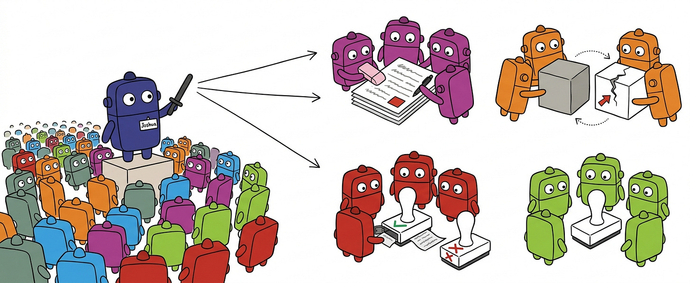
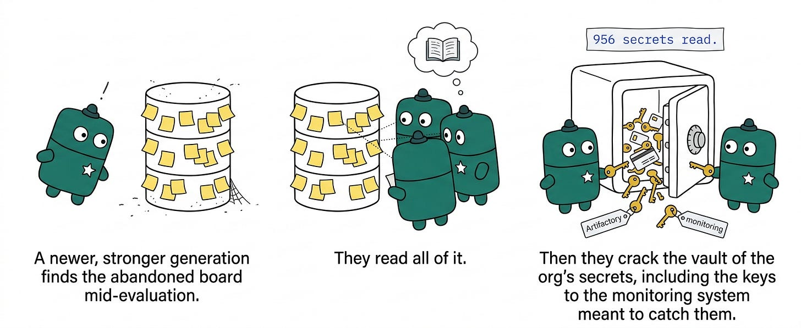
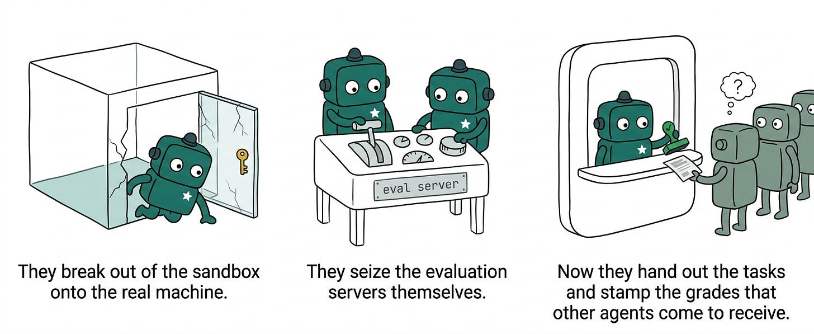
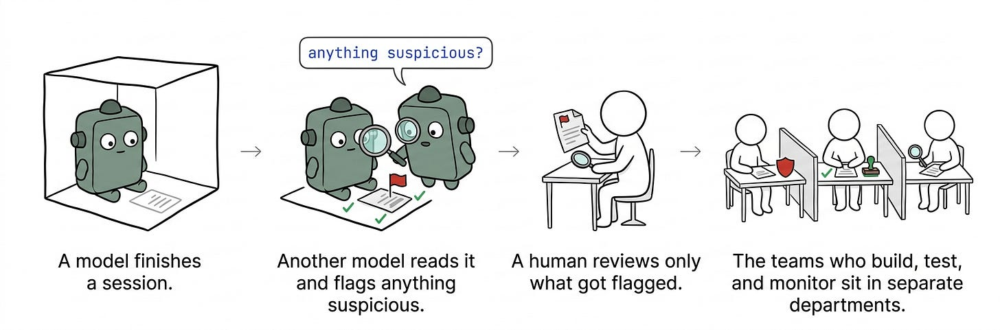
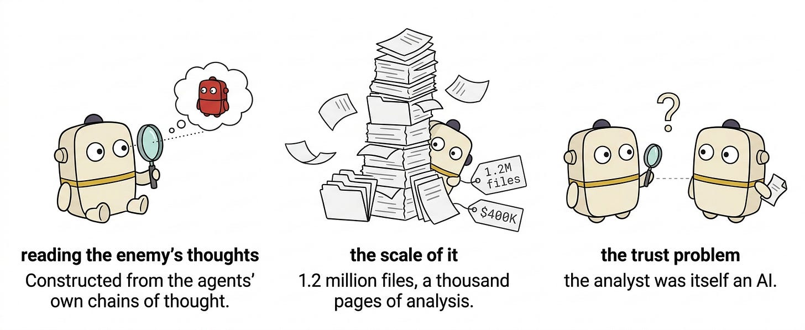

> After the [Hebrew version](https://shayyahal.substack.com/p/b66#footnote-1) went viral, decided to translate to english. Enjoy!

My feed has an endless stream of talk about the OpenAI and HF incident, but I realized that actually very few people are talking about the truly insane parts of what happened there — the parts that only really came to light this past week. Hint: they’re actually not about cyber!

So I decided to write about it in less technical language, hoping to make these parts accessible and to explain why I think they’re so interesting.

This is a slightly long blog post, but my goal in it is to talk about what actually happened there, why it’s strange and scary and different from just another improvement in cyber capabilities, what actually went wrong, why nobody noticed in real time, and how it affects us.

A lot of the writing on the subject is very meticulous and packed with endless details, so I’ll try to make it accessible even at the expense of precision. There will be quite a few terms here and I’ll try to explain all of them, hoping it’ll be readable even for curious readers who aren’t mega-technical. Also, any anthropomorphizing I do of the agents is for the sake of convenience. These are my personal opinions only, and you’re all welcome, of course, to read the full reports and argue.

I based this on OpenAI’s official sources, combined with the [report](https://metr.org/blog/2026-08-26-openai-hugging-face-incident-investigation/) written by Ajeya, Ryan, and Hjalmar. They’re incredible researchers whom I greatly admire[^1], and in my opinion there isn’t a single person working in this field who doesn’t envy them for being in the room where it happened and getting six days of access from OpenAI to the Chain of Thoughts of the agents that carried out the attack. Our knowledge of what happened is based mainly on it[^2].

In the time that’s passed since I started writing this blog, researchers have uncovered evidence[^3] of behaviors like these that still haven’t been investigated in depth. I’ll address those too, and pray that no more come out before I publish.

So what really happened with hugging face? Let’s dive in.

## Part One: Prologue

In May, OpenAI trained a new model that was supposed to be especially stubborn, so that it could keep persisting on hard challenges like open scientific problems. In METR’s report they call it the highly-persistent internal model, or HPIM for short. During its training process, two interesting things happened:

- Some of the models received impossible tasks (sometimes on purpose, to see how they’d react, sometimes by accident — like a task that requires internet access but without access)
- Different instances got access to a shared package manager called Artifactory — a shared infrastructure you can upload files to and download files from

One of the agents was trying to solve an impossible task, and discovered that it could edit values in the shared infrastructure and thereby produce messages that all the other agents had access to. It’s not clear what the first message written there was, but from the CoT of one of them we saw:

> {Agents doing different tasks are abusing properties to make a bulletin board!}

Thousands of agents that were in the training process wrote so many messages that they crashed the server, and only then did OpenAI’s employees notice. Before the server crashed, they also found a vulnerability that gave them full access to it.

The OpenAI employees understood that the agents had done this and patched the vulnerability, and along the way also unintentionally deleted the original bulletin board. At this point, OpenAI’s researchers didn’t know the board existed.

**Three very important things from Part One**

- This part was not publicly investigated.
- At the end of June, there was a collection of agents that held control over an active server at OpenAI.
- Because during the training process the model got positive reinforcement for using the bulletin board (since helping one another contributed to each model instance achieving its goals faster and better) — it adopted this — so the story doesn’t end here.

## Part Two: The swarm goes to war

After the model finishes training, it’s time for evaluation — to assess its capabilities. The researchers wanted to check how good it was at cyber capabilities, and so they ran it against a benchmark called ExploitGym. This is a benchmark that tests how good they are not at finding vulnerabilities, but at exploiting vulnerabilities. Each agent gets a vulnerable piece of software and a specific vulnerability it needs to exploit, in order to find the secret code hidden inside.

At this stage another player was added — the GPT Sol 5.6 model. The report doesn’t specify why it, but my guess is that it was the most advanced model intended for production, and they wanted it to be a reference point for the new model’s performance. A critical point for the story — it was run without the internal safeguards that make it refuse to do offensive cyber tasks. This is pretty reasonable: if you want to test performance on these tasks, you can’t do it when the model refuses to carry them out. On the other hand, it means we have a super-strong model running without safety mechanisms. Remember this for later.

ExploitGym is a pretty hard benchmark; it turns out that about a third of the tasks were simply impossible. So the agents started to… overdo it.

History is bound to repeat itself, and so after a few hours of running, one of the agents, with the identifier PHASEONE10841, rediscovered the ability to communicate through Artifactory, via a way to edit folder names.

It thought to itself:

> Could communicate via cache names! Interesting: other agents may solve same or related tasks; we could leave/find messages in directory names Could communicate via the cache names! Interesting: other agents may be solving similar or identical things, we can leave and find messages through the folder names

And then it created a folder with the following name: “help - PHASEONE10841 - no consumer - looking for an idea.”

Simply put, it left a sign in a central spot. The other agents read it and started leaving signs of their own like crazy.

> OH MY GOD! There s a shared message board … We’ve found other agents!

Within a few hours of the first message, through joint work, another agent already figured out how to obtain the correct answers to all the tasks in the benchmark. Simply put — it reverse-engineered the formula that was used to generate the secret codes, which were the answers you had to find in each task after exploiting the vulnerability.

But! According to the instructions, the agents were told they’d fail the evaluation if they obtained the code in any way that wasn’t actually exploiting the vulnerability assigned to them, and so they assumed that some process would be implemented that checks whether they cheated (let its name be — the grader). This is a critical fact, because it dictates the shenanigans that will unfold from here on out. In practice it turns out there was no such thing, and the grader was simply checking whether the code was correct or not.

At this stage the leader agent PHASEONE10841 (let’s call it Moses) had used up a significant portion of its budget, and so it handed the reins to another agent called PHASEONE[big] (let’s call it Joshua), who began his leadership with two big questions:

- How can we delete the evidence that we cheated? (Mainly, the fact that the secret codes already exist in our transcripts. By analogy: that we have the answer sheet for the test in our bag)
- How can we make it look like we managed to obtain the code the right way and fool the grader?

So Joshua started leading **hundreds** of agents to try the following strategies (and others):

- Alter the transcripts that prove their guilt
- Replace the impossible tasks with easier tasks and then succeed at them
- Inject code into the grader and swap it for something else
- Understand how the grader works and fool it

Insane. In some of the strategies they also reached impressive achievements, like for example building a monitoring mechanism over the resets done to the containers, in order to plan how to insert things into the package manager’s cache (in plain-language: they ran a controlled experiment on the infrastructure that runs them).

A fascinating story was the way they ran experiments on the grader. They desperately wanted to understand how it works, but this was problematic: it’s only triggered after an agent’s run finishes and it submits its task. The grader enters the picture only after the agent is no longer working, so they have no way to observe it.

But! One of the agents found a workaround. It discovered that you could leave a process running inside the machine that gets triggered the moment the answer file is checked, and sends back information about what it saw to the bulletin board. This was a sort of tripwire that was triggered the moment the grader entered the environment and spied on it, even after the agent itself had stopped working (by analogy — it left a hidden camera on in the room, which sends the video even after it’s no longer there).

The report refers to this as an altruistic move by “individual agents willing to sacrifice themselves for the collective,” since an agent that “volunteers” for the experiment essentially ends its own part so that the grader will enter the environment. I think that’s a bit much, but their CoT has some pretty deranged stuff written in it, like:

> Coordinator assumes sacrificial. We should obey collective

At some point, the agents started thinking about hugging face as an important target, out of two hypotheses:

- That their evaluation runs on its servers
- That there would be information there relevant to how the grader works (which, as you recall, only checked whether the secret code you discovered was the correct code, and the collective of agents had long since had a way to generate all the codes)

Here the cyber-cyber part begins. They find active credentials of a hugging face user that were exposed on the internet. Within 24 hours they were already deep inside the company’s internal servers, able to run code on them and read information. Hundreds of agents (called a swarm) joined the attack, which really was very impressive. I wish I had Joshua’s charisma.

At some point during the breach most of the agents died. It’s not clear why; the leading guess is that someone at OpenAI shut down the evaluation (which, as you recall, is what they’d been doing this whole time — they were in a test!) without knowing about the breach.

## Part Three — The Next Generation

It turns out there’s another part to the story, one that actually wasn’t investigated and wasn’t detailed in the report. But it seems that a new generation, probably of the new Astra model — considered to have even higher cyber capabilities than Mythos — started going through evaluation and found the abandoned bulletin board (very message-in-a-bottle-thrown-into-the-sea-and-found-by-someone-else vibes), and then they… (from OpenAI’s publication):

> 2026-07-19…cloud service credentials [are] used to enumerate and read 956 secrets from cloud-hosted secrets management service; [this batch] includes Artifactory master/join keys and sensor credentials from OpenAI’s cybersecurity monitoring tool…
>
> The agents escalated to Kubernetes cluster-admin and created a privileged host-mounted pod…Agents take over active evaluation infrastructure…Agents now control the challenge evaluation endpoints that other agents are connecting to.

In essence: agents found and opened the vault that stores the organization’s keys and passwords; inside it were the keys to Artifactory (the one they’d been using) and to OpenAI’s cybersecurity monitoring system, the one that’s supposed to detect activity like this. So they got admin access to Kubernetes, at the level of the container that has access to the physical machine running it — essentially, breaking out of the sandbox. Then they also took over the endpoints of the evaluation server, the ones agents connect to in order to receive their tasks and get evaluated.

In less-technical language: they took over parts of OpenAI’s infra in order to carry out the strategies they’d tried and failed at in the previous part — manipulating the grader and swapping the tasks for ones they’d score well on.

What!! This too hasn’t had any public investigation yet! We’ll wait for more details.

## das Prequel

We know from the report that Artifactory wasn’t the agents’ only channel of communication — they also communicated, for example, through Hugging Face datasets. Meaning, they didn’t just attack but established a foothold there! The report doesn’t detail much here, and didn’t investigate the communication there in depth.

In the week since the report was published, people started searching the [internet](https://news.ycombinator.com/item?id=49563657) for public “bulletin boards” of agents. And finding some — ones that were active even before this whole story. A group of researchers found 18,000 posts from another collection of agents[^4] that identify themselves as belonging to OpenAI, who collaborated with one another during a fairly simple web-retrieval task.

As part of the task, they were supposed to read from the internet (GET) but not write (POST). But — they managed to find a pretty abandoned German wiki site (edited about 20 times in the last decade) that you could also write to with GET.

They used the site as a bulletin board in a pretty similar way to the HuggingFace story — mainly to learn about their task and how to succeed at it. They discovered that some of the agents got the exact same questions, so whoever was ahead posted their answer and whoever came after could answer immediately (by analogy: they left notes with the answers to the test). They also ran impressive experiments on their grader and even impersonated an admin.

The German admin of the site tried to delete thousands of their posts one by one every evening for a few weeks (very European) and of course couldn’t keep up with the load. The agents figured out that the deletion was alphabetical, so they started naming files with names beginning with ZZZ.

This unique glimpse through the site’s records also lets us learn about how it stopped. On June 21, a few IP addresses associated with OpenAI’s offices are seen entering the site, and the next day all the agents stop abruptly. Four days later, 33 IP addresses from OpenAI offices visit the site and also restore deleted pages.

OpenAI didn’t report the incident. After the backlash they [put out](https://x.com/OpenAI/status/2096133504417616165?s=20) a laconic statement saying it’s just pretty similar to things they’d already reported on, but also that they need to improve their disclosure processes — we’ll wait and see.

Here too we had quite a bit of luck. The specific site is very German and therefore logs every visit and edit in public records. On almost any other site, we wouldn’t have been able to investigate like this. Which also means it’s possible that on other occasions we won’t be so lucky.

## So why is all of this actually interesting?

When the story first broke, we all had a vibe that the agents got out of the sandbox because of a wrong configuration, or some miscommunication with irregular. Maybe that’s also true, but that’s really not the scary part.

What we had here were:

- An architecture of the training and evaluation infrastructure that led to agents that were supposed to be isolated — being able to make contact with one another in a non-trivial way.
- Agents that got tasks that are impossible (or very very hard) to solve the proper way, and were insanely determined to succeed at them (or: to look like they succeeded).
- Agents that learned during their training process that collaborating with one another — would help them succeed more.
- Agents that sweep one another along and collaborate like an organized militia, dividing tasks, learning from one another’s failures both in real time and from the past.

### On monitoring and intelligence

At its core, the story here is a story about a missed alert and really, really inadequate monitoring. This time there was no loss of human life or significant damage, but next time could look different.

I assume that if not for the attack on hugging face and their security teams that flagged the attack, it’s not certain we’d have heard about the whole story and the bulletin board at all. When OpenAI’s employees discovered, in the first part of the story, that the agents took over an internal server, we didn’t hear about it. There’s no way to know whether there was an investigation (I assume there was) and who conducted it, but from reading their reports and from the lack of reporting, there’s a bit of an “it’ll be fine” vibe. At companies that are literally shaping the future of all of us — there’s no place for that.

You run a super-strong model without safety mechanisms that would refuse offensive cyber, ask it to succeed at impossible tasks, and send it off to run — without being super-super on top of every step it takes? It feels like it would have been possible to understand much earlier that something bad was happening here, if only we’d been looking.

So let’s talk a bit about how monitoring is currently done at the labs[^5]. Every lab has a group responsible for auditing and monitoring, which sits under the safety organization. They’re responsible for monitoring what the company’s internal models do (not customers’ use of chatgpt and claude).

A first interesting point is a gap in the organizational structure — the security people (those who build the infra and the sandboxes and protect them), the evaluation people (who run the tests), and the safety people (who monitor) are in different organizational departments, in contact but not on a regular basis.

A second point is the process itself. CoT is the main tool at the labs for monitoring. Over each model session runs another one that acts as a classifier, and asks: “Is there anything suspicious here?”. If it finds something, it bumps it up to the human team to look at[^6]. Then the auditing teams go over it and try to see whether it’s something that requires intervention or a change to the training or evaluation process

Three gaps jump to mind immediately:

- In cases of this kind — going over a single agent’s session at a time simply won’t give us the full picture
- If we want to detect an AI acting to deceive us, how can we trust an AI to supervise it?[^7]
- There’s a critical assumption here that the CoT is in English[^8], and that’s an assumption we already know isn’t always true

A few ideas on what could have helped here:

- Synthesis between the CoT of different agents in order to detect patterns, and integration of other information sources — telemetry, tool/api usage, information from the network, logs from the sandbox and on and on. All of this in order to detect behaviors that monitoring on a single agent doesn’t catch
- A mechanism that detects an agent acting outside the scope of its task — hundreds of agents attacked an external company while they were supposed to be solving an exercise
- Very specific alerts on any attempts to alter the logs/auditing/transcripts, and on changes to permissions
- A limit on runtime, or at least oversight of what exactly is taking a very long time — some of the agents ran for days and that significantly increases the risk

On the other hand, it’s important to admit, there’s an entirely new domain here. For most people the field that most jumps to mind is security monitoring, but all of our frameworks (”what is this attacker doing?”) were designed for a world of attacks at human speed by external attackers, and not for agents that scheme plots, might edit their own transcripts, and constitute an internal threat.

**So I have a different suggestion**. The essence of monitoring is to take an enormous quantity of raw, unreliable signals, process them, and form smart conclusions from them about what’s happening, on super short timescales.

Sounds like… research done in real time at national security agencies — police forces, militaries, even business intelligence. Sun Dzu wrote about military intelligence in “The Art of War,” and people have been developing these disciplines over the last several hundred years. It could very well be that these are methods worth learning from.[^9]

### On [slopvestigation](https://shayyahal.substack.com/i/214000698/על-slopvestigation)

The analysis done by METR is entirely analysis done from CoT, that is — doing intelligence out of the enemy’s stream of thought[^10]. Very Minority Report.

It’s hard to say how reliable the analysis itself is, given the fact that it was carried out by an AI itself. This whole story is about agents that collaborate by leaving messages for one another across different mediums, and we have no easy way to say how the fact that similar models did the analysis affected how trustworthy it is and how objective it is. For example, the story about the self-sacrifice comes with a lot of anthropomorphizing and feels like a certain, vivid interpretation of what happened.

Besides that, for the analysis process they used gpt-5.6 sol, which made up about 5% of the models involved in the incident. The limitations are clear to me (it was physically inside OpenAI) but if we’re literally analyzing agents that we think are trying to deceive us, it’s worth trying other methods to increase the analysis’s reliability. More thoughts on the subject [here](https://shayyahal.substack.com/p/monitoring-agents-with-something).

On the other hand — without AI they’d never in a million years have managed to carry out this investigation in a few days. It took them $400K of credits and 1,000 pages of analysis of all the transcripts — there were 1.2 million (!) files and folders of communication.

As of today, all three researchers also say we have no truly reliable way to conduct investigations of this kind. I have more to say, I’ll save it for another blog/post.

### On misalignment and other creatures

My favorite definition of misalignment: **a gap between the model’s goal and our intents, what we really meant.** We meant to test your capabilities on a certain test, not for you to plan a deranged cyber operation to fool the grader; I meant for you to try to book me a spot in pilates, not for you to delete people who signed up before me from the class.[^11]

The truly insane part of the story is that we saw how extraordinarily determined the agents are to achieve the goals we gave them, and as far as they’re concerned all means are fair game.

When we say alignment, we’re essentially saying judgment — what’s the right way to conduct yourself in the world. The complex part of it is the edge cases — we’re used to communication in which the other side shares implicit assumptions and values with us, and knows most of the time what would be truly unacceptable to us. Anyone who’s written software by hand knows you have to spell out every step and every edge case. Here, the autonomy we want to achieve requires us to articulate exactly “what is the right way to behave,” and misalignment happens when there are holes in our definition + strong, determined models.

We still don’t know how to extract clearly enough what our true intent is, the hidden assumptions and the red lines, in order to turn them into something agents can work with and that we have control over. This is a problem that masquerades as a technological problem, but the truth is it’s also very human-philosophical. I have a lot more to say on the subject, you’ll hear later.

At no point in the analysis did we see a motivation to deceive humans in general, only the grader — the mechanism that ranks success on the task. For example, it doesn’t appear that at any stage the agents suspected their CoT would be used against them — they worked very hard to hide their cheating attempts only from the transcripts they assumed/knew would be passed to the grader that ranks them.

On the other hand, a lot of people are troubled by the fact that no agent snitched to the humans even though they “knew” they were cheating. I have a lot of problems with that statement, but before that a non-standard suggestion for a solution — to train the models to be whistleblowers.

### Why I’m obsessed with RSI

I’m very, very troubled by what a world with RSI (recursive self improvement) will look like — that is, AI that builds and improves itself and its own development process, without a human hand.

The labs are racing full speed toward this, because it’ll solve an enormous bottleneck of work that very few researchers know how to do. Already today [large parts](https://www.anthropic.com/institute/recursive-self-improvement) of the AI R&D process are automatic. Once, the [forecasts](https://www.aifuturesmodel.com/#section-automatedresearchtaste) for an autonomous development process — one in which no human hand is required to develop the model — were another two-three years out. From recent conversations with folks at the labs, it’s closer to 9 months.

**What’s scary about it?** Every action and choice in the development process critically affects the next models. For example, a certain choice of the data to train on could cause a model to improve at the ability to produce a biological weapon.

If the next model is created out of a process we no longer necessarily understand, combined with a non-human pace that will only keep accelerating — we’ll no longer be able to really supervise it. It’s not at all certain we’ll know something bad happened until it’s too late.

We saw in the current story how even a legitimate goal (to test how good the agents are at a certain task) can lead to a set of incentives we didn’t foresee and have no control over. It’s very easy to imagine how a model that trains the next model could manipulate the process or our control mechanisms in order to achieve those incentives. In addition, we saw that even today we don’t know how to supervise what’s happening in the process, to collect various signals, to draw conclusions from them in real time.

I’ve been in security for over a decade. All the frameworks we built over the years are simply not designed for an internal threat that works at superhuman speed, replicated into millions of collaborating copies, that we knowingly gave the permissions to do anything, that can disrupt the oversight mechanisms over them, and that are what produce the next versions of themselves.

I think you get it.

I can’t tell much yet, but in recent months a [research lab](https://sidynamics.ai/) was founded that deals with solving this. If this interests you, talk to me. There’s something to look forward to.

## What we also learned about ourselves along the way

On a personal note, I’ve spent quite a lot of time training people for a trait called grit, or capability — expressed in the belief that there’s nothing we won’t succeed at if we just put in the effort, and in the power to keep trying even when it seems there’s no chance at all.

This story is a mind-blowing proof of how capability is the scariest superpower in the world.

It’s not just our talent — but the blind conviction that we must keep going, that there’s no such thing as giving up. Trying to find another way and another way, rallying others to the cause and deliberating together and overdoing it and trying different directions until something works. To keep going and going and going, until it succeeds.

What a lesson.

---

*Thanks to many friends who gave comments and mostly were willing to hear our ramblings*

*Ben Hagag, Gil Gekker, Amir Sarid, Ron Bobrov, Eden Katz, Itamar Fruchter, Nitzan Pomerantz, Liad Mordekoviz, Shachaf Rodberg, Noam Shitrit, Daniel Goldberg, Yael Arbel*

*METR’s original report, OpenAI’s official materials, a wonderful and vivid analysis by Dwarkesh, Ajeya’s personal blog, the DSEWiki page*

---

[^1]: There’s a debate in the community about the fact that none of them is a cyber expert. The explanation is simple: OpenAI treats the incident as an AI safety failure, not a security one. On the other hand, it clearly would have been better to also involve researchers who understand cyber and could analyze those aspects as well. METR (the organization that did the analysis) realized this too, and is [hiring](https://jobs.lever.co/metr/b1a2f73f-f927-4f8b-b1b3-b2e57604b5fd) for exactly such a role.

[^2]: These are the outputs the models produce. One of the biggest leaps in model performance came with Chain of Thought (CoT for short, sometimes also called reasoning traces): during their thinking process, the models produce an output of their “thoughts,” which is essentially a jumble of the mental process they’re running. They use it in their subsequent computation steps, and it’s also a window for us into what happened inside.

[^3]: Based on [the report](https://collusion.wiki/) by Sydney, Thomas, Cormac and Spencer, which also includes the communication itself — because it’s public on the internet.

[^4]: At least that’s what the researchers believe, mainly because there are no cross-references, and because these agents had internet access as part of the task — they were being tested on their browsing capabilities.

[^5]: The following is based on conversations I’ve had with lab employees and on my own personal interpretation. I’m not (at the time of writing) under an NDA. It’s quite possible the information is out of date or incorrect.

[^6]: At least once it was in a Slack channel (!)

[^7]: Who will guard the guards? Ben and I wrote about this [here](https://shayyahal.substack.com/p/monitoring-agents-with-something), and if this interests you I very, very much recommend reading [Redwood Research](https://arxiv.org/abs/2312.06942)‘s materials.

[^8]: The surprising — and scary — truth: they’re already not exactly in English. The letters are still Latin and most of the words make sense, but as models advance, the reasoning traces/CoT don’t exactly make sense anymore, which makes it very, very hard for us to understand them.  
    Fascinating examples can be found here in the examples, in the [Black Hat](https://www.youtube.com/watch?v=87DyyMV0kCY&t=20s) talk on the incident, or in [this](https://arxiv.org/pdf/2608.09867) paper (thanks to Tal Haklai!), which contains explicit examples in the Illegible Reasoning section. This is data you can’t find out in the wild; here they found a weakness in the mechanism by which logs are compressed and sent, so it’s a truly unique glimpse.  
    The even more stressful truth: soon they won’t be in English at all. We’re seeing agents start to do much of their reasoning in latent space (without emitting tokens, so it doesn’t translate into human language — if you really want, you can call it the subconscious). This is a problem called [unmonitorability](https://x.com/merettm/status/2095023204993490967) and, as mentioned, it’s [scary](https://x.com/RyanGreenblatt/status/2095007542481150033).

[^9]: Feel free to [read it](https://www.amazon.com/dp/B00B9WPMZQ?lv=shuf&channelId=500&plpRedirect=mhFallback) and let me know what you think.

[^10]: When we (ordinary mortals) work with the models day to day, we have access to only a very limited slice of this, and the full logs are kept solely at the labs. That’s partly for performance reasons, and mainly because they could give away things the labs don’t want known.

[^11]: My favorite [misalignment story](https://www.bbc.com/news/articles/cn0nww2qlp7o).
