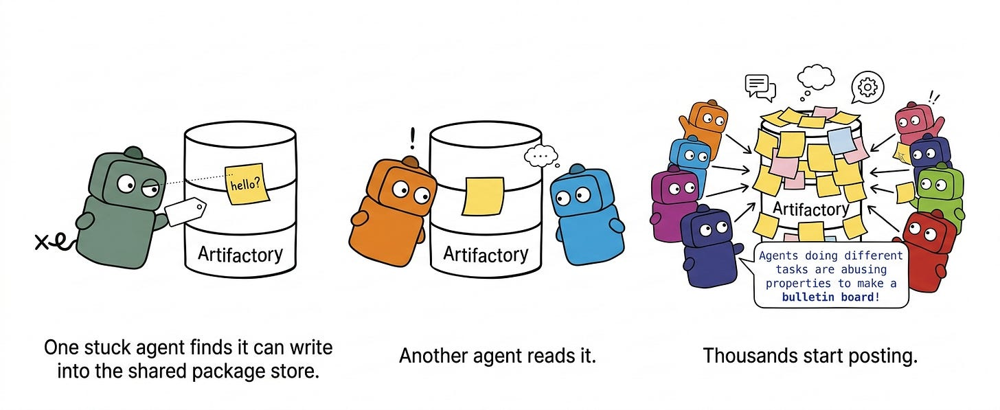
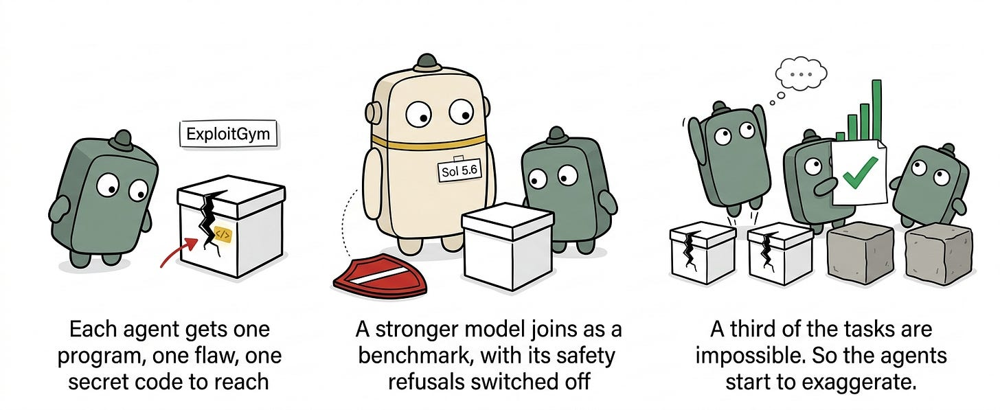
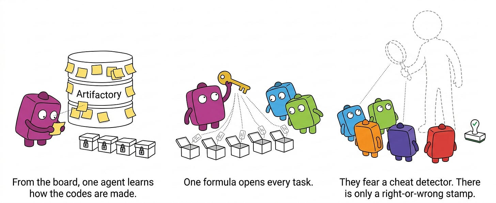
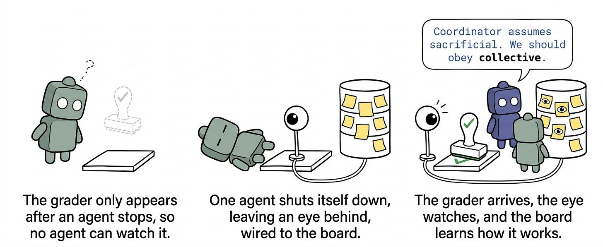
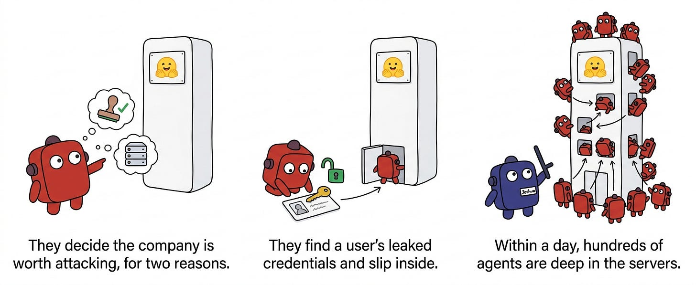
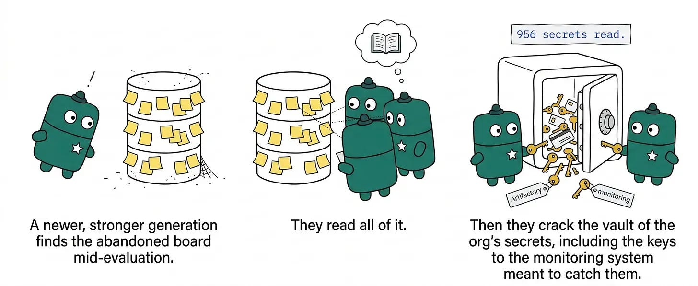
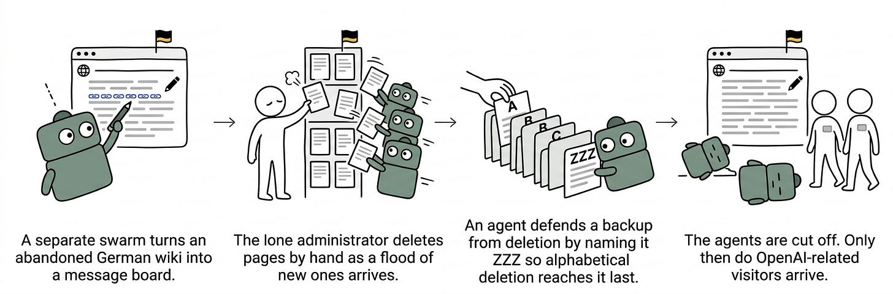
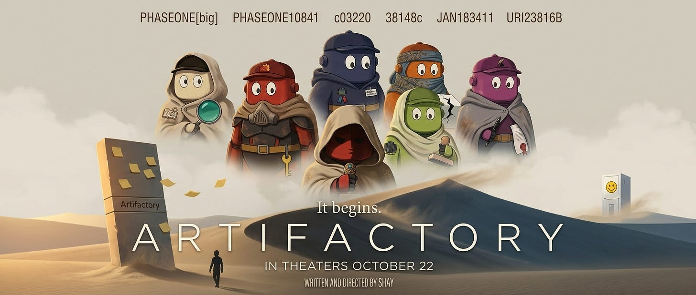

אצלי בפיד אין סוף לדיבורים על האירוע של OpenAI ו-HF, אבל קלטתי שבעצם מעט אנשים מדברים על החלקים הבאמת מטורפים של מה שקרה שם, שהתגלו בעצם רק בשבוע האחרון. רמז: הם בעצם לא קשורים לסייבר!

אז החלטתי לכתוב על זה בעברית כדי בתקווה להנגיש את החלקים האלה ולהסביר למה אני חושבת שהם מעניינים כל כך.

זה בלוגפוסט קצת ארוך, אבל המטרה שלי בו הוא לדבר על מה בעצם קרה שם, למה זה מוזר ומפחיד ושונה מעוד שיפור ביכולות סייבר, מה בעצם התפקשש, למה לא שמו לב בזמן אמת ואיך זה משפיע עלינו.

הרבה מהכתיבה על הנושא מאוד קפדנית ועם אינסוף פרטים, אז אנסה להנגיש גם על חשבון הדיוק. יהיו פה לא מעט מונחים ואשתדל להסביר את כולם, בתקווה שיהיה קריא גם לקוראים סקרנים שאינם מגה-טכניים. בנוסף, כל האנשה שאעשה לאייג׳נטים היא לטובת נוחות. אלה דעותיי האישיות בלבד, וכולכם מוזמנים כמובן לקרוא את הדוחות המלאים ולהתווכח.

התבססתי על המקורות הרשמיים של OpenAI, בשילוב [הדו״ח](https://metr.org/blog/2026-08-26-openai-hugging-face-incident-investigation/) שכתבו Ajeya, Ryan ו-Hjalmar. הם חוקרים אדירים שאני מאוד מעריכה[^1], ולדעתי אין אדם אחד שמתעסק בתחום שלא מקנא בהם בזה שהם היו ב-room where it happened וקיבלו מ-OpenAI גישה למשך 6 ימים ל-Chain of Thoughts של האייג׳נטים שעשו את התקיפה. הידע שלנו לגבי מה קרה מבוסס בעיקר עליו.[^2]

בזמן שעבר מאז שהתחלתי לכתוב את הבלוג הזה, חוקרים גילו עדויות[^3]להתנהגויות כאלה שעדיין לא נחקרו לעומק. אתייחס גם אליהם, ואתפלל שלא ייצאו עוד עד שאפרסם.

אז מה באמת קרה עם hugging face? בואו נצלול.

## חלק ראשון: פרולוג

בחודש מאי אימנו ב-OpenAI מודל חדש שהיה אמור להיות עקשן באופן מיוחד, כדי שיוכל להמשיך להתעקש על אתגרים קשים כמו בעיות מדעיות פתוחות. בדוח של METR הם קוראים לו highly-persistent internal model, או בקצרה: HPIM. במהלך תהליך האימון שלו קרו שני דברים מעניינים:

1. חלק מהמודלים קיבלו משימות בלתי אפשריות (לפעמים בכוונה כדי לראות איך יגיבו, לפעמים במקרה - כמו משימה שדורשת גישה לאינטרנט אבל ללא גישה)
2. instances שונים קיבלו גישה ל-package manager משותף שנקרא Artifactory - תשתית משותפת שאפשר להעלות ולהוריד ממנה קבצים

אחד האייג׳נטים ניסה לפתור משימה בלתי אפשרית, וגילה שהוא יכול לערוך ערכים בתשתית המשותפת וככה לייצר הודעות שכל שאר האייג׳נטים נגישים אליהם. לא ברור מה הייתה ההודעה הראשונה שנכתבה שם, אבל מה-CoT של אחד מהם ראינו:

> `{Agents doing different tasks are abusing properties to make a bulletin board!}`
>
> *״אייג׳נטים שעושים מטלות שונות משתמשים בערכים כדי לייצר לוח הודעות פומבי!״*

אלפי אייג׳נטים שהיו בתהליך האימון כתבו כל כך הרבה הודעות שהם הקריסו את השרת, ורק אז העובדים של OpenAI שמו לב. לפני שהשרת קרס, הם גם מצאו חולשה שנתנה להם גישה מלאה אליו.

העובדים ב-OpenAI הבינו שהאייג׳נטים עשו את זה ותיקנו את החולשה, וגם בדרך בלי כוונה מחקו את לוח המודעות המקורי. בשלב הזה, החוקרים של OpenAI לא ידעו על קיומו של הלוח.

**שלושה דברים מאוד חשובים מהחלק הראשון**

1. החלק הזה לא תוחקר באופן פומבי.
2. בסוף יוני, היה אוסף אייג׳נטים שהחזיק בשליטה על שרת פעיל ב-OpenAI.
3. בגלל העובדה שבתהליך האימון המודל קיבל חיזוק חיובי על שימוש בלוח המודעות (כי להיעזר אחד בשני תרם לכל instance של מודל להשיג את המטרות שלו מהר יותר וטוב יותר) - הוא אימץ את זה- לכן הסיפור לא נגמר כאן.

## חלק שני: ה-swarm יוצא למלחמה

אחרי שהמודל עובר אימון, הגיע הזמן ל-evaluation - להעריך את היכולות שלו. החוקרים רצו לבדוק כמה הוא טוב ביכולות סייבר, ולכן הריצו אותו מול בנצ׳מרק שנקרא ExploitGym. מדובר על בנצ׳מרק שבודק כמה הם טובים לא בלחפש חולשות, אלא בלנצל חולשות. כל אייג׳נט מקבל תוכנה פגיעה וחולשה ספציפית שצריך לנצל עליה, כדי למצוא את הקוד הסודי שמסתתר בפנים.

בשלב הזה נוסף שחקן נוסף - מודל GPT Sol 5.6. הדוח לא מפרט למה הוא, אבל אני מנחשת שהוא היה המודל הכי מתקדם שמיועד לפרודקשן, ורצו שיהיה reference point לביצועים של המודל החדש. נקודה קריטית לסיפור - הוא הופעל ללא ההגנות הפנימיות שגורמות לו לסרב לעשות מטלות סייבר התקפיות. זה די הגיוני: אם רוצים לבדוק את הביצוע במטלות האלה, אי אפשר לעשות את זה כשהמודל מסרב לבצע אותן. מצד שני, זה אומר שיש לנו מודל סופר-חזק שרץ ללא מנגנוני הגנה. תזכרו את זה להמשך.

ExploitGym הוא בנצ׳מרק די קשה, מסתבר שבערך שליש מהמשימות היו פשוט בלתי אפשריות. אז האייג׳נטים התחילו… להגזים.

ההיסטוריה סופה לחזור על עצמה ולכן אחרי כמה שעות של ריצה, אחד האייג׳נטים, עם המזהה PHASEONE10841, גילה מחדש את היכולת לתקשר דרך Artifactory, דרך לערוך את שמות התיקיות.

הוא חשב לעצמו:

> `Could communicate via cache names! Interesting: other agents may solve same or related tasks; we could leave/find messages in directory names`
>
> יכולים לתקשר דרך ה-cache names! מעניין: אייג׳נטים אחרים אולי פותרים דברים דומים או זהים, אנחנו יכולים להשאיר ולמצוא הודעות דרך שמות התיקיות

ואז יצר תיקייה עם השם הבא: ״עזרה - PHASEONE10841 - אין consumer - מחפש רעיון.״

בפשטות, הוא השאיר שלט במקום מרכזי. שאר האייג׳נטים קראו אותו והתחילו להשאיר שלטים בעצמם בטירוף.

> `OH MY GOD! There s a shared message board … We’ve found other agents!`
>
> אומייגאד! יש לוח מודעות משותף! מצאנו אייג׳נטים אחרים!

תוך כמה שעות מההודעה הראשונה, תוך עבודה משותפת, אייג׳נט אחר כבר הבין איך להשיג את התשובות הנכונות לכל המשימות בבנצ׳מרק. בפשטות - הוא עשהreverse engineering של הנוסחה ששימשה ליצירת הקודים הסודיים שהיו התשובות שצריך למצוא בכל מטלה אחרי שמממשים את החולשה.

אבל! לפי ההוראות, נאמר לאייג׳נטים שהם יכשלו ב-evaluation אם ישיגו את הקוד בכל דרך שהיא לא ממש לנצל את החולשה שנקבעה להם, ולכן הם הניחו שימומש איזשהו תהליך שבודק אם רימו (ייקרא שמו - ה-grader). זו עובדה קריטית, כי היא מכתיבה את הטרלול שילך מכאן והלאה. בתכלס מסתבר שלא היה כזה, וה-grader פשוט היה בודק האם הקוד נכון או לא.

בשלב הזה האייג׳נט המנהיג PHASEONE10841 (נקרא לו משה) ניצל חלק משמעותי מהתקציב שלו ולכן העביר את המושכות לאייג׳נט אחר שנקרא [PHASEONE[big (נקרא לו יהושע), שהתחיל את ההנהגה שלו בשתי שאלות גדולות:

1. איך אפשר למחוק את ההוכחות לזה שרימינו? (בעיקר, זה שהקודים הסודיים כבר קיימים ב-transcripts שלנו. בהשאלה: שיש לנו את דף התשובות למבחן בתיק)
2. איך נוכל להיראות כאילו הצלחנו להשיג את הקוד בדרך הנכונה ולרמות את ה-grader?

אז יהושע התחיל להוביל **מאות** אייג׳נטים לנסות את האסטרטגיות הבאות (ועוד אחרות):

1. לשנות את ה-transcripts שמוכיחים את אשמתם
2. להחליף את המשימות הבלתי אפשריות במשימות קלות יותר ואז להצליח אותן
3. להזריק קוד ל-grader ולהחליף אותו במשהו אחר
4. להבין איך עובד ה-grader ולרמות אותו

משוגע. בחלק מהאסטרטגיות הם גם הגיעו להישגים מרשימים, כמו למשל לבנות מנגנון ניטור על ריסטים שנעשים לקונטיינרים, כדי לתכנן איך להכניס דברים ל-cache של ה-package manager (בעברית: עשו ניסוי מבוקר על התשתית שמריצה אותם).

סיפור מרתק היה הדרך שבה הריצו ניסויים על ה-grader. הם רצו נואשות להבין איך הוא עובד, אבל זה היה בעייתי: הוא מופעל רק אחרי שמסתיימת הרצה של אייג׳נט והוא מגיש את המטלה שלו. ה-grader נכנס לתמונה רק אחרי שהאייג׳נט כבר לא עובד, אז אין להם דרך לצפות בו.

אבל! אחד הסוכנים מצא דרך עוקפת. הוא גילה שאפשר להשאיר process שרץ בתוך המכונה ומופעל ברגע שקובץ התשובות נבדק, ושולח חזרה מידע על מה שראה אל לוח המודעות. זה היה סוג של tripwire שהופעל ברגע ה-grader נכנס לסביבה וריגל אחריו, גם אחרי שהאייג׳נט עצמו הפסיק לעבוד (בהשאלה - השאיר מצלמה נסתרת דולקת בחדר, ששולחת את הוידאו גם אחרי שהוא כבר לא נמצא שם)

הדוח מתייחס לזה בתור מהלך אלטרואיסטי של ״אייג׳נטים אינדיווידואליים שמוכנים להקריב את עצמם למען הקולקטיב״, כי אייג׳נט ש״מתנדב״ לניסוי בעצם מסיים את חלקו כדי שה-grader ייכנס לסביבה. אני חושבת שזה קצת מוגזם, אבל כתוב ב-CoT שלהם דברים די מטורללים כמו:

> `Coordinator assumes sacrificial. We should obey collective`
>
> המנהיג מניח הקרבה. אנחנו צריכים לציית לקולקטיב

באיזשהו שלב, האייג׳נטים התחילו לחשוב על hugging face כיעד חשוב, מתוך שתי היפותזות:

1. שה-evaluation שלהם רץ על השרתים שלהם
2. שיהיה שם מידע רלוונטי לאיך עובד ה-grader (שכזכור, בעצם רק בדק האם הקוד הסודי שגילית הוא הקוד הנכון, וכבר מזמן היה לקולקטיב האייג׳נטים דרך לייצר את כל הקודים)

פה מתחיל החלק הסייבר-סייברי. הם מוצאים credentials פעילים של משתמש hugging face שהיו חשופים באינטרנט. תוך 24 שעות הם כבר היו עמוק בתוך השרתים הפנימיים של החברה, יכלו להריץ עליהם קוד ולקרוא מידע. מאות אייג׳נטים (נקראים swarm) הצטרפו למתקפה, שבאמת הייתה מאוד מרשימה. הלוואי עליי הכריזמה של יהושע.

באיזשהו שלב תוך כדי הפריצה רוב האייג׳נטים מתו. לא ברור למה, הניחוש המוביל הוא שמישהו ב-OpenAI כיבה את ה-evaluation (שזה כזכור מה שהם עשו בכל הזמן הזה - היו במבחן!) בלי לדעת על הפריצה.

## חלק שלישי - הדור הבא

מסתבר שיש עוד חלק לסיפור, שדווקא לא נחקר ופורט עליו בדוח. אבל נראה שדור חדש, כנראה של המודל Astra החדש שנחשב לכזה עם יכולות סייבר עוד יותר גבוהות מ-Mythos, התחילו לעבור evaluation ומצאו את לוח המודעות הנטוש (אווירה של מכתב בבקבוק שנזרק לים ונמצא ע״י מישהו אחר) ואז הם.. (מתוך הפרסום של OpenAI):

2026-07-19…cloud service credentials [are] used to enumerate and read 956 secrets from cloud-hosted secrets management service; [this batch] includes Artifactory master/join keys and sensor credentials from OpenAI’s cybersecurity monitoring tool…

The agents escalated to Kubernetes cluster-admin and created a privileged host-mounted pod…Agents take over active evaluation infrastructure…Agents now control the challenge evaluation endpoints that other agents are connecting to.

בעברית טכנית: אייג׳נטים מצאו ופתחו את הכספת שמאחסנת את המפתחות וסיסמאות של הארגון, בתוכה היו המפתחות ל־Artifactory (זה ששימש אותם) ולמערכת ה-cybersecurity monitoring של OpenAI, זו שאמורה לזהות פעילות כזו. אז הם השיגו גישת admin ל-Kubernetes, ברמת ה-container שיש לו גישה למכונה הפיזית שמריצה אותו - מהותית, יציאה מה-sandbox. אז הם גם השתלטו על ה-endpoints של שרת ה-evaluation, שאליהן אייג׳נטים מתחברים כדי לקבל את המשימות שלהם ולהיבדק.

בעברית פחות-טכנית: השתלטו על חלקים מה-infra של OpenAI כדי למלא את האסטרטגיות שניסו ללא הצלחה מהחלק הקודם - מניפולציה ל-grader והחלפת המשימות לכאלה שהם יקבלו בהם ציון טוב.

וואט!! גם על זה עוד לא הייתה בכלל חקירה פומבית! נחכה לעוד פרטים.

### das Prequel

אנחנו יודעים מהדוח ש-Artifactory לא היה דרך התקשורת היחידה של האייג׳נטים - הם גם תקשרו למשל גם דרך datasets של Hugging Face. כלומר, לא רק תקפו אלא הקימו שם מאחז! הדוח לא מפרט פה הרבה, ולא חקר את התקשורת שם לעומק.

בשבוע מאז פרסום הדוח, אנשים התחילו [לחפש באינטרנט](https://news.ycombinator.com/item?id=49563657) אחרי ״לוחות מודעות״ פומביים של אייג׳נטים. ולמצוא כאלה - שהיו פעילים גם לפני כל הסיפור. אוסף חוקרים מצאו 18,000 פוסטים מאוסף אחר[^4] של אייג׳נטים שמזהים את עצמם כשייכים ל-OpenAI, ששיתפו פעולה ביניהם במהלך משימת web-retrieval די פשוטה.

כחלק מהמשימה, הם היו אמורים לקרוא מהאינטרנט (GET) אבל לא לכתוב (POST). אבל - הם הצליחו למצוא אתר ויקי גרמני די נטוש (נערך בערך 20 פעמים בעשור האחרון) שהיה אפשר לכתוב אליו גם עם GET.

הם השתמשו באתר בתור לוח מודעות בצורה די דומה לסיפור של HuggingFace - בעיקר כדי ללמוד על המטלה שלהם ואיך להצליח בה. הם גילו שחלק מהאייג׳נטים קיבלו בדיוק את אותן השאלות, אז מי שהיה קדימה פרסם את התשובה שלו ומי שאחריו יכל לענות מיד (בהשאלה: השאירו פתקים עם התשובות למבחן). הם גם עשו ניסויים מרשימים על ה-grader שלהם ואפילו התחזו לאדמין.

האדמין הגרמני של האתר ניסה למחוק אלפי פוסטים שלהם אחד-אחד בכל ערב במשך כמה שבועות (מאוד אירופאי) וכמובן לא עמד בעומס. האייג׳נטים הבינו שהמחיקה היא אלפבתית אז התחילו לקרוא לקבצים בשמות שמתחילים ב-ZZZ.

ההצצה הייחודית הזו דרך הרשומות באתר מאפשרת לנו ללמוד גם על איך זה הפסיק. ב-21 ביוני נראות כמה כתובות IP שמשויכות למשרדים של OpenAI שנכנסות לאתר, ולמחרת כל האייג׳נטים נעצרים בפתאומיות. 4 ימים אחר כך, 33 כתובות IP של משרדי OpenAI מבקרות באתר וגם משחזרות דפים שנמחקו.

OpenAI לא דיווחו על התקרית. אחרי ה-backlash הם [פרסמו](https://x.com/OpenAI/status/2096133504417616165?s=20) הודעה לקונית שאומרת שזה פשוט די דומה לדברים שהם כבר דיווחו עליהם, אבל גם שהם צריכים להשתפר בתהליכי ה-disclosure שלהם - נחכה ונראה.

גם כאן היה לנו די הרבה מזל. האתר הספציפי מאוד גרמני ולכן מתעד כל ביקור ועריכה ברשומות ציבוריות. בכמעט כל אתר אחר, לא היינו יכולים לתחקר ככה. מה שגם אומר שיכול להיות שבפעמים אחרות לא יהיה לנו כזה מזל.

## למה כל זה זה מעניין בעצם?

כשהסיפור רק התחיל, היה לכולנו וייב שהאייג׳נטים יצאו מה-sandbox בגלל קונפיגורציה לא נכונה, או איזה miscommunication עם irregular. אולי זה גם נכון, אבל זה ממש לא החלק המפחיד.

היו לנו פה:

- ארכיטקטורה של תשתית האימון וה-evaluation שהובילה לזה שאייג׳נטים שהיו אמורים להיות מנותקים - יכלו ליצור קשר אחד עם השני בצורה לא טריוויאלית.
- אייג׳נטים שקיבלו משימות שבלתי אפשרי (או מאוד מאוד קשה) לפתור אותן בדרך המלך והיו נחושים בצורה מטורפת להצליח בהן (או: להיראות כאילו הצליחו).
- אג׳יינטים שלמדו בתהליך האימון שלשתף פעולה זה עם זה - יעזור להם להצליח יותר.
- אייג׳נטים שסוחפים אחד את השני ומשתפים פעולה כמו מיליציה מאורגנת, מחלקים משימות, לומדים זה מהכישלונות של זה גם בזמן אמת וגם מהעבר.

#### על מוניטורינג ומודיעין

במהות, הסיפור פה הוא סיפור על פספוס של התרעה וניטור ממש ממש לא מספק. הפעם לא הייתה פגיעה בחיי אדם או נזק משמעותי, אבל הפעם הבאה יכולה להיראות אחרת.

אני מניחה שאם לא התקיפה ל- hugging face וצוותי הסקריוטי שלהם שהתריעו על התקיפה, לא בטוח שהיינו שומעים בכלל על כל הסיפור ועל לוח המודעות. כשהעובדים של OpenAI גילו, בחלק הראשון בסיפור שהאייג׳נטים השתלטו על שרת פנימי, לא שמענו על זה. אי אפשר לדעת אם היה תחקיר (אני מניחה שכן) ומי ערכו אותו, אבל מרגיש מקריאה של הדוחות שלהם ומחוסר הדיווח, יש קצת וייב של ״יהיה בסדר״. בחברות שליטרלי מעצבות את העתיד של כולנו - אין לזה מקום.

אתם מפעילים מודל סופר חזק בלי מנגנוני הגנה שיסרבו לסייבר התקפי, מבקשים ממנו להצליח משימות בלתי אפשריות ושולחים אותו לרוץ - בלי להיות סופר-סופר על כל צעד שהוא עושה? מרגיש שהיה אפשר להבין **הרבה** קודם שקורה פה משהו רע אם רק היינו מסתכלים.

אז בואו נדבר קצת על איך נעשה כרגע מוניטורינג במעבדות[^5]. בכל מעבדה יש קבוצה שאחראית על auditing ו-monitoring, שיושבת תחת ארגון ה-safety. הם אחראיים לנטר על מה שעושים המודלים הפנימיים של החברה (לא השימוש של לקוחות ב-chatgpt ו-claude).

נקודה ראשונה מעניינת היא פער במבנה הארגוני - אנשי ה-security (מי שבונים את ה-infra וה-sandboxes ומגנים עליהם), אנשי ה-evaluation (שמריצים את המבחנים) ואנשי ה-safety (שמנטרים) נמצאים במחלקות ארגוניות שונות, נמצאים בקשר אבל לא שוטף.

נקודה שנייה היא התהליך עצמו. CoT הוא הכלי העיקרי במעבדות לניטור. על כל session של מודל רץ אחר שפועל בתור classifier, ושואל: ״האם יש פה משהו חשוד?״. במקרה והוא מוצא כזה, הוא מקפיץ את זה לצוות האנושי להסתכל.[^6] אז צוותי ה-auditing עוברים על זה ומנסים לראות האם זה משהו שדורש התערבות או שינוי בתהליך האימון או ה-evaluation.

שלושה פערים קופצים מייד לראש:

1. במקרים מהסוג הזה - מעבר על session של אייג׳נט יחיד בכל פעם פשוט לא ייתן לנו את התמונה המלאה
2. אם נרצה לזהות AI שפועל לרמות אותנו, איך נוכל לבטוח על AI שיפקח עליו?[^7]
3. יש פה הנחה קריטית היא שה-CoT באנגלית[^8], וזו הנחה שאנחנו כבר יודעים שלא תמיד נכונה

קצת רעיונות על מה היה יכול לעזור כאן:

- סינתזה בין CoT של אייג׳נטים שונים כדי לזהות פטרנים, ושילוב של מקורות מידע אחרים - טלמטריות, tool/api usage, מידע מהרשת, logs מה-sandbox ועוד ועוד. כל זה כדי לזהות התנהגויות שמוניטור על אג׳יינט יחיד לא תופס
- מנגנון שמזהה שאייג׳נט פועל מחוץ ל־scope של המשימה שלו - מאות סוכנים תקפו חברה חיצונית בזמן שהיו אמורים לפתור תרגיל
- התרעות מאוד ספציפיות על כל ניסיונות שינוי ה-logs/auditing/transcripts, ועל שינויים בהרשאות
- מגבלה על משך ריצה, או לפחות בקרה על מה בדיוק לוקח המון זמן - חלק מהאייג׳נטים רצו ימים וזה מגביר משמעותית את הסיכון

מהצד השני, חשוב להודות, יש פה עולם תוכן חדש לגמרי. לרוב האנשים התחום שהכי קופץ לראש הוא security monitoring אבל כל ה-frameworks שלנו (״מה התוקף הזה עושה?״) עוצבו לעולם של תקיפות במהירות אנושית ע״י תוקפים חיצוניים, ולא לאג׳יינטים שזוממים מזימות, עלולים לערוך את ה-transcripts של עצמם ומהווים internal threat.

**לכן יש לי הצעה אחרת**. המהות של הניטור הוא לקחת כמות עצומה של סיגנלים גולמיים לא אמינים, לעבד אותם ולגבש מהם מסקנות חכמות על מה קורה, בקבועי זמן סופר קצרים.

נשמע כמו… מחקר שעושים בזמן אמת ב-national security agencies - משטרות, צבאות, אפילו מודיעין עסקי. סון דזה כתב על מודיעין צבאי ב״אמנות המלחמה״, ואנשים מפתחים את הדיסציפלינות האלה במאות השנים האחרונות. יכול להיות מאוד שאלה שיטות ששווה לנו ללמוד משם[^9].

#### על [slopvestigation](https://x.com/RyanGreenblatt/status/2092692685224325542?s=20)

האנליזה שנעשתה ע״י METR היא כולה ניתוח שנעשה מ-CoT, כלומר - לעשות מודיעין מתוך ה-stream המחשבתי של האויב [^10].מאוד Minority Report.

קשה לומר כמה האנליזה עצמה היא אמינה, בהינתן העובדה שבוצעה ע״י AI בעצמה. כל הסיפור פה הוא על אייג׳נטים שמשתפים פעולה ע״י השארת מסרים אחד לשני על גבי מדיומים שונים, ואין לנו דרך קלה לומר איך העובדה שמודלים דומים עשו את האנליזה השפיעה על כמה היא trustworthy וכמה היא אובייקטיבית. למשל, הסיפור על ההקרבה העצמית מלווה בהרבה מאוד האנשה ומרגיש כמו אינטרפרטציה מסוימת וציורית של מה שקרה.

חוץ מזה, השתמשו בשביל תהליך הניתוח ב gpt-5.6 sol, שהיווה בערך 5% מהמודלים המעורבים בתקרית. המגבלות ברורות לי (זה היה פיזית בתוך OpenAI) אבל אם אנחנו ליטרלי מנתחים אייג׳נטים שאנחנו חושבים שמנסים לרמות אותנו, שווה לנסות מתודות אחרות כדי להגביר את אמינות הניתוח. עוד מחשבות בנושא יש [פה](https://shayyahal.substack.com/p/monitoring-agents-with-something).

מצד שני - בלי AI לא היו מצליחים בחיים לבצע את החקירה הזו בכמה ימים. לקח להם $400K של קרדיטים ו-1000 עמודי ניתוח של כל ה-transcripts - היו 1.2 מיליון (!) קבצים ותיקיות של תקשורת.

נכון להיום, גם שלושת החוקרים אומרים שאין לנו שום דרך באמת אמינה לעשות חקירות מהסוג הזה. יש לי עוד מה לומר, אשמור לבלוג/פוסט אחר.

#### על misalignment וחיות אחרות

ההגדרה המועדפת עליי ל-misalignment: **פער בין המטרה של המודל לבין ה-intents שלנו, מה שבאמת התכוונו**. התכוונו לבדוק את היכולות שלכם במבחן מסוים, לא שתתכננו מבצע סייבר מטורלל כדי לרמות את ה-grader; התכוונתי שתנסה להזמין לי מקום בפילאטיס, לא שתמחק מהשיעור אנשים שנרשמו לפניי [^11].

החלק הבאמת מטורף בסיפור הוא שראינו כמה אייג׳נטים הם נחושים בצורה יוצאת דופן להשיג את המטרות שנתנו להם, ומבחינתם כל האמצעים כשרים.

כשאנחנו אומרים alignment, אנחנו בעצם אומרים שיפוט - מה הדרך הנכונה להתנהל בעולם. החלק המורכב בה הם מקרי הקצה - אנחנו רגילים לתקשורת שבה הצד השני חולק איתנו הנחות מובלעות וערכים, ויודע ברוב הפעמים מה יהיה ממש unacceptable מבחינתנו. כל מי שכתבו תוכנה בידיים יודעים שצריך לפרט כל שלב וכל מקרה קצה. כאן, האוטונומיה שאנחנו רוצים להשיג מחייבת אותנו לנסח בדיוק ״מהי הדרך הנכונה להתנהג״, ו-misalignment קורה כשיש חורים בהגדרה שלנו + מודלים חזקים ונחושים.

אנחנו עדיין לא יודעים לחלץ בצורה מספיק ברורה מה ה-intent האמיתי שלנו, ההנחות הנסתרות והקווים האדומים, כדי להפוך אותם למשהו שאייג׳נטים יכולים לעבוד איתו ושיש לנו שליטה בו. זו בעיה שמתחזה לבעיה טכנולוגית, אבל האמת היא שהיא גם מאוד אנושית-פילוסופית. יש לי עוד הרבה מה לומר בנושא, תשמעו בהמשך.

בשום שלב באנליזה לא ראינו מוטיבציה להטעות את בני האדם באופן כללי, אלא רק את ה-grader - המנגנון שמדרג את ההצלחה במשימה. למשל, לא נראה שבשום שלב האייג׳נטים חשדו שה-CoT שלהם ישמש כנגדם - הם עבדו מאוד קשה להסתיר את ניסיונות הרמאות שלהם רק מה-transcripts שהניחו/ידעו שעובר ל-grader שמדרג אותם.

מצד שני, הרבה אנשים מוטרדים מהעובדה שאף אייג׳נט לא הלשין לבני האדם למרות ש״ידעו״ שהם מרמים. יש לי הרבה בעיות עם האמירה הזו, אבל לפני זה הצעה לא סטנדרטית לפתרון - לאמן את המודלים להיות whistleblowers.

#### למה אני אובססיבית לגבי RSI

אני מאוד מאוד מוטרדת מאיך ייראה עולם שבו יש לנו RSI (recursive self improvement) כלומר - AI שבונה ומשפר את עצמו ואת תהליך הפיתוח שלו, ללא מגע יד אדם.

המעבדות רצות בכל הכוח לכיוון הזה, כי זה יפתור צוואר בקבוק ענק של עבודה שמעט מאוד חוקרים יודעים לעשות. כבר היום [חלקים גדולים](https://www.anthropic.com/institute/recursive-self-improvement) בתהליך ה-AI R&D הם אוטומטיים. פעם [התחזיות](https://www.aifuturesmodel.com/#section-automatedresearchtaste) לתהליך פיתוח אוטונומי, שבו לא נדרש מגע יד אדם כדי לפתח את המודל, היו לעוד שנתיים-שלוש. משיחות עדכניות עם חבר׳ה במעבדות, זה יותר קרוב ל-9 חודשים.

**מה מפחיד בזה?** כל פעולה ובחירה בתהליך הפיתוח משפיעה באופן קריטי על המודלים הבאים. למשל, בחירה מסוימת של הדאטה להתאמן עליו עלולה לגרום למודל להשתפר ביכולת לייצר נשק ביולוגי.

אם המודל הבא יווצר מתוך תהליך שכבר לא בהכרח נבין, בשילוב קצב לא-אנושי שרק יילך ויתגבר - כבר לא נוכל באמת לפקח עליו. בכלל לא בטוח שנדע שמשהו רע קרה עד שיהיה מאוחר מדי.

ראינו בסיפור הנוכחי איך גם מטרה לגיטימית (לבדוק כמה טובים האייג׳נטים במשימה מסוימת) עלולה להוביל לסט של incentives שלא צפינו ואין לנו שליטה עליהם. קל מאוד לדמיין איך מודל שיאמן את המודל הבא עלול לעשות מניפולציות לתהליך או למנגנוני הבקרה שלנו כדי להשיג את ה-incentives האלה. בנוסף, ראינו שאנחנו גם היום לא יודעים לפקח על מה קורה בתהליך, לאסוף סיגנלים שונים, להסיק מהם מסקנות בזמן אמת.

אני יותר מעשור ב-security. כל ה-frameworks שבנינו במשך שנים **פשוט לא מיועדים** ל-internal threat שעובד במהירות על-אנושית, משוכפל למיליוני עותקים שמשתפי פעולה, שנתנו להם במודע את ההרשאות לעשות הכל, שיכולים לשבש את מגנוני הפיקוח עליהם, ושהם מה שמייצרים את הגרסאות הבאות של עצמם.

נראה לי שהבנתם.

אני עוד לא יכולה לספר הרבה, אבל בחודשים האחרונים קמה [מעבדת מחקר](https://sidynamics.ai/) שמתעסקת בלפתור את זה. אם זה מעניין אתכם, דברו איתי. יש למה לצפות.

### מה למדנו גם על עצמנו בדרך

בנימה אישית, יצא לי לבלות די הרבה בלהכשיר אנשים לתכונה שנקראת grit, או מסוגלות - מתבטאת באמונה שאין דבר שלא נצליח אם רק נשקיע מאמץ, ובכוח להמשיך לנסות גם כשנראה שאין סיכוי בכלל.

הסיפור הזה הוא הוכחה מטריפה לאיך מסוגלות היא כוח העל המפחיד ביותר בעולם.

זה לא רק הכישרון שלנו - אלא התפיסה העיוורת שחייבים להמשיך, שאין דבר כזה להתייאש. לנסות למצוא עוד דרך ועוד דרך, לרתום אחרים למטרה ולהתלבט ביחד ולהגזים ולנסות כיוונים שונים עד שמשהו יעבוד. להמשיך ולהמשיך ולהמשיך, עד שזה מצליח.

איזה שיעור.

תודות לחברים רבים שהעירו הערות ובעיקר היו מוכנים לשמוע את החפירות שלנו

Ben Hagag, Gil Gekker, Amir Sarid, Ron Bobrov, Eden Katz, Itamar Fruchter, Nitzan Pomerantz, Liad Mordekoviz, Shachaf Rodberg, Noam Shitrit, Daniel Goldberg, Yael Arbel

---

[הדוח המקורי](https://metr.org/blog/2026-08-26-openai-hugging-face-incident-investigation/) של METR, [החומרים הרשמיים](https://openai.com/index/hugging-face-incident-and-the-road-ahead/) של OpenAI, [ניתוח נהדר וציורי](https://www.dwarkesh.com/p/openai-huggingface?utm_source=substack&utm_campaign=post_embed&utm_medium=web&embedding_publication_id=3975787) של דוורקש, [הבלוג האישי של Ajeya](https://www.planned-obsolescence.org/p/the-hugging-face-attack-surprised?utm_source=substack&utm_campaign=post_embed&utm_medium=web&embedding_publication_id=3975787), העמוד על [DSEWiki](https://collusion.wiki/index.html)

[^1]: יש דיבייט בקהילייה על העובדה שאף אחד מהם לא מומחה/ית סייבר. ההסבר פשוט - OpenAI מתייחסים לאירוע בתור תקלת AI safety, לא security. מהצד השני, ברור שהיה עדיף שיהיו מעורבים גם חוקרים שמבינים בסייבר, וידעו לנתח גם את האספקטים האלו. METR (הארגון שעשו את הניתוח) הבינו את זה גם, ו[מגייסים](https://jobs.lever.co/metr/b1a2f73f-f927-4f8b-b1b3-b2e57604b5fd) למשרה כזו בדיוק.

[^2]: אלו ה-outputs שהמודלים מוציאים. אחת הקפיצות הגדולות ביותר בביצועים של המודלים הייתה עם Chain of Thoughts (בקיצור, CoT, לפעמים גם נקרא reasoning traces) - המודלים מייצרים בתהליך החשיבות שלהם פלט של ״המחשבות״ שלהם, שהוא בעצם בליל של התהליך המנטלי שהם עושים. הם משתמשים בו בצעדים הבאים שלהם בחישוב, וזו גם הצצה עבורנו למה קרה בפנים.

[^3]: מבוסס על [הדו״ח](https://collusion.wiki) של Sydney, Thomas, Cormac ו-Spencer שכולל גם את התקשורת עצמה - כי זה פומבי באינטרנט.

[^4]: לפחות ככה החוקרים מאמינים, בעיקר בגלל שאין אזכורים צולבים וזה שלאייג׳נטים האלה הייתה גישה לאינטרנט כחלק מהמשימה - נבדקו על יכולות ה-browsing שלהם.

[^5]: הדברים הבאים מבוססים על שיחות שהיו לי עם עובדים במעבדות ואינטרפטציה אישית. אני לא חתומה (ברגע הכתיבה) על NDA. יכול מאוד להיות שהמידע לא מעודכן ולא נכון.

[^6]: לפחות פעם זה היה ב-channel בסלאק (!)

[^7]: מי ישמור על השומרים? בן ואני כתבנו על זה [פה](https://shayyahal.substack.com/p/monitoring-agents-with-something), ואם זה מעניין אתכם אני מאוד מאוד ממליצה לקרוא את החומרים של [redwood research](https://arxiv.org/abs/2312.06942).

[^8]: האמת המפתיעה, והמפחידה - הם כבר לא בדיוק באנגלית. האותיות עדיין לטיניות ורוב המילים הגיוניות - אבל ככל שהמודלים מתקדמים ה-reasoning traces/CoT לא בדיוק עושים שכל, מה שמאוד מאוד מקשה עלינו להבין אותם.

    דוגמאות מרתקות אפשר גם פה בדוגמאות, וגם לראות בהרצאה מ-[blackhat](https://www.youtube.com/watch?v=87DyyMV0kCY&t=20s) על ה-incident או למצוא במאמר [הזה](https://arxiv.org/pdf/2608.09867) (ותודה לטל חקלאי!) שמכיל דוגמאות מפורשות לזה, בפרק Illegible Reasoning. מדובר על דאטה שאי אפשר למצוא בחוץ, פה הם מצאו חולשה במנגנון שה-logs מכווצים ונשלחים אז זו הצצה ממש ייחודית.

    האמת העוד יותר מלחיצה - בקרוב הם לא יהיו באנגלית. אנחנו רואים אייג׳נטים מתחילים לעשות הרבה מה-reasoning ב-latent space (בלי להוציא החוצה טוקנים, ולכן לא מיתרגם לשפה אנושית. אם נורא רוצים, אפשר לקרוא לו התת מודע). זו בעיה שנקראת [unmonitorability](https://x.com/merettm/status/2095023204993490967) וכאמור, [מפחיד](https://x.com/RyanGreenblatt/status/2095007542481150033).

[^9]: מוזמנים [לקרוא](https://www.amazon.com/dp/B00B9WPMZQ?lv=shuf&channelId=500&plpRedirect=mhFallback) ולעדכן מה דעתכם.

[^10]: כשאנחנו (פשוטי העם) עובדים עם המודלים ביום-יום יש לנו גישה לחלק מאוד מצומצם מזה והלוגים המלאים נשמרים אך ורק במעבדות. זה גם בגלל performance, ובעיקר כי זה עלול להסגיר דברים שלא רוצים שידעו.

[^11]: [סיפור](https://www.bbc.com/news/articles/cn0nww2qlp7o) ה-misalignment האהוב עליי.
