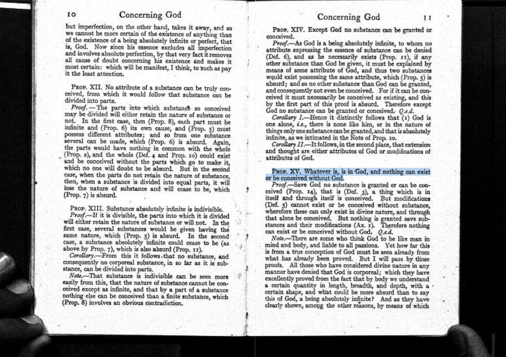

הפעם הראשונה שהוכחה מתמטית פוצצה לי את המוח לגמרי לא קרתה בחוג למתמטיקה. היא קרתה כשקראתי את ההוכחה של שפינוזה לקיום האל.

הייתי בשנה הראשונה, וזה אפילו לא היה בסילבוס. אבל פספסתי את השיעור, אז לקחתי את ה*אתיקה* מהספרייה. זה ספר קצר, שבנוי בצורה גיאומטרית - הוא מתחיל מאקסיומות, משתמש בהן כדי להוכיח טענות, וככה בונה טענה לוגית על טענה לוגית. ואז, בעמוד 11, מופיע הדבר הזה:

> ״כל מה שישנו, ישנו באלוהים, ושום דבר אינו יכול להיות או להיות מושג בלי אלוהים.״ 
> [נובע ממשפט 14 ומהגדרה 3]

פאק. חוץ מזה שהטענה עצמה מטורפת - אין שום דרך לא להסכים איתה. ההוכחה פשוט סוחבת אותך לשם.

---

בשבוע שעבר [טרנס טאו](https://www.youtube.com/watch?v=Q8Fkpi18QXU), מגדולי המתמטיקאים של זמננו, פרסם מאמר נפלא בשם *[Mathematics in the Age of AI](https://arxiv.org/abs/2608.16753)*, עם כתיבה מתמטית-פילוסופית כל כך אלגנטית שהיא הזכירה לי את ה*אתיקה*. דוגמה מדהימה לשימוש בקפדנות מתמטית כדי להגיד משהו משמעותי ומעניין על העולם שסביבנו.

המרוץ המטורף לעבר אינטליגנציה גנרית שאמורה [להחליף את כל](https://www.nature.com/articles/d41586-026-02566-6) עבודת הידע שלנו מעמת אותנו עם שאלות אתיות בסיסיות בכל תחום - מה המטרות שלנו, היעדים שלנו, הערכים שלנו, כולל אלה שמתחת לפני השטח ושאף פעם לא אמרנו בקול? מה ההנחות הסמויות שלנו? איך מפרמלים בנוסחה מה זו הצלחה? ואיך מוודאים שהמדד שהגדרנו להצלחה הוא באמת המדד הנכון?

בקצרה, הטיעון שלו הולך ככה: איך אנחנו מגדירים הצלחה בפתרון בעיות מתמטיות?

(1) אם נגדיר אותה כ״לפתור כמה שיותר בעיות פתוחות״, אנחנו עלולים לקבל המון פתרונות שגויים. זה חוק גודהארט - עשינו אופטימיזציה חזקה מדי על המדד.

(2) אם נגדיר אותה כ״לפתור כמה שיותר בעיות פתוחות ולוודא שהפתרון נכון״, אנחנו עלולים לקבל פתרונות שאנחנו לא מבינים.

(3) אז עדיף שנגדיר אותה כ״לפתור כמה שיותר בעיות פתוחות, לוודא שהפתרון נכון, ולדאוג שאפשר להעביר אותם לקהילה המתמטית בצורה שהיא מבינה״. מעולה — רק שכדי שהוכחה מתמטית תתרום לקידום המתמטיקה, היא צריכה ללמד אותנו משהו על איך עושים מתמטיקה. אחרים צריכים לעכל אותה, וגם לקבל אותה, ולהשתמש בה בעבודה שלהם.

(4) מה שאומר שהמטרה הופכת להיות: ״לפתור כמה שיותר בעיות פתוחות, לוודא שהפתרון נכון, לדאוג שאפשר להעביר אותם בצורה ברורה, ולגרום לקהילה המתמטית לקבל ולעכל אותם״ - כלומר, שיהפכו לקנוניים, שייטמעו באמת בדרך שבה עושים מתמטיקה. וזה כמובן תהליך הרבה יותר איטי, ארוך ועדין, וקשה יותר להעריך אותו.

**אנחנו לא רוצים רק לפתור את הבעיות. אנחנו רוצים לתת לדרך שעשינו לשנות אותנו.**

המוסדות האקדמיים נולדו לתוך עולם של מחסור בהוכחות, וכשנגיע לשפע הם הולכים להתקשות מאוד. כל מי שהגיש מאמר לכנס מדעי גדול בשנה האחרונה יודע שזה לא נדיר לראות 50,000 (!) הגשות.

הסיבה שה-slop כל כך קשה לנו היא שהוא מכריח אותנו - כחברה וכאינדיבידואלים - לצלול לעומק ולבחון מחדש מה טוב ומה רע, בקצב הרבה יותר גבוה ממה שאנחנו רגילים אליו.

לקראת סוף ה*אתיקה*, שפינוזה מנסה לעזור לנו להבדיל ביניהם, וטוען טענה מוסרית מדהימה:

> ״אין אנו יודעים בוודאות שדבר כלשהו הוא טוב או רע, אלא מה שמביא באמת לידי הבנה, או מה שעלול למנוע אותנו מהבנה.״

הבנה היא הדבר היחיד שאנחנו יודעים בוודאות שהוא טוב. כל השאר טוב רק אם הוא משרת את ההבנה או נובע ממנה.

כלומר - ערימה של הוכחות נכונות שאף אחד לא מבין, ואפליקציות שלקח לנו רגע לג׳נרט ועוד רגע לשכוח, ופוסטים בבלוג שעשויים ממשפטים קצרים: אף אחד מהם לא טוב, כי הם לא מקדמים אותנו כאנושות.

טוב הוא רק מה שמגדיל את הכוח שלנו לפעול בעולם, מה שמשנה את הדרך שבה אנחנו עצמנו חושבים ועובדים ויוצרים. זו התנועה עצמה.

אצל שפינוזה, ״יותר טוב״ לא אומר להיות יותר מוסרי - זה אומר להיות יותר קיים. פשוט, להיות יותר.

וואו. איזה שיעור.

---

נ.ב. - אחד הסיפורים האהובים עליי הוא איך, בגיל 24, הקהילה היהודית הפורטוגזית הטילה עליו *חרם* חמור, בגלל ״הכפירות הנתעבות שהוא נהג בהן ולימד״ בתפיסות שלו לגבי מה זה אלוהים.

כשהוא קיבל את הבשורה, הוא ענה: ״מוטב כך. זה מכריח אותי לא לעשות שום דבר שלא הייתי עושה מרצוני, אילולא פחדתי משערורייה.״

*מוטב כך.* איזה אייקון.
