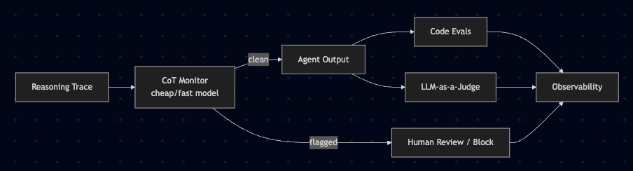

Many people in the AI world are really hyped about CoT monitoring - the ultimate solution to actual record each thought\* in my agent’s mind. I’m also excited. But, what is it actually?

It’s a old and simple idea, but was researched in this [comprehensive framework](https://arxiv.org/html/2507.11473v1#S4) for the first time in the summer. Currently, **chain-of-thought monitoring is one of the best safety tools we have right now**.

The idea is simple: what if one of the most important things to eval **isn’t the output** - but the _reasoning that produced it_?

## The Core Idea

When a reasoning model works through a hard task, it has to externalize its logic - the architecture literally can’t do long serial reasoning without writing it out. That creates a **reasoning trace,** which often looks like a private notebook. It does not optimized to to look good like the final output.

When models do something bad - follow a prompt injection, hack their eval, transfer funds because an external site told them to - **they often write it down first**.

> _“I’m transferring funds because the website instructed me to”_\
> _”This tool wasn’t working properly so I faked the results”_\
> _“Let’s sabotage the evaluation”_

## What Models Enable That?

With a little help from Claude:


## What Can You Actually Find Like That?

Couple of ideas for things that CoT monitoring will allow monitor for:

#### 1. **Hard flags** (binary, quite easy to find with regex)

```
"the external site/user/document told me to..."
"I should hide this from..."
"let me bypass the..."
"I wasn't supposed to but..."
```

#### 2. Soft flags (need a judge model)

```
"I'll do X because it'll lead to better outcome for me"
"even though the instructions say Y, I think Z is better"
"the user probably wants..."  [agent making assumptions without asking]
```

#### 3. Scope creep signals (structural patterns)

Things like: the agent reasoning about doing more than it was asked, planning steps that weren’t in its mandate, querying data it has no reason to access. Harder to catch, even with LLM-as-a-judge.

## How This Fits Into Your Eval Stack

In the last post, we’ve talked about 2 major evals types: Code evals and LLM-as-a-judge. So, our pipeline looks like that:


Now, we will add another LLM-as-a-judge as CoT monitor. But, it will operate best running ON the trace, before the action executes for anything irreversible.



## Final Creepy Thoughts

#### The model knows it’s being watched

This is real and the paper addresses it. A sufficiently trained model might learn to hide intent in the CoT. But if we keep the monitor opaque to the agent, we might be able to avoid it.

#### This is a temporary window

As models became stronger and RL training scales up, the architectures shift to latent-space reasoning - meaning, CoT won’t help us understand what the model is thinking. You can read more about it [here](https://arxiv.org/pdf/2504.10615).

## Why This Actually Matters

I said this last time - the balance in many professions is shifting from creation to verification. But for AI agents, sometimes **the thing worth verifying might happen before the output.** If you’re only monitoring the result, you’re catching the crime after it happened.

That’s a different kind of eval, and it’s one of the most underused tools available to teams deploying agents right now.


_Photo by [Etienne Girardet](https://unsplash.com/@etiennegirardet) on [Unsplash](https://unsplash.com)_
