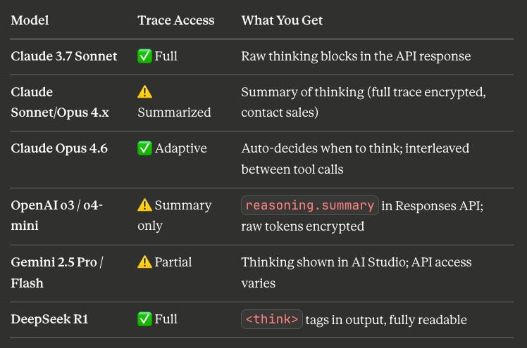
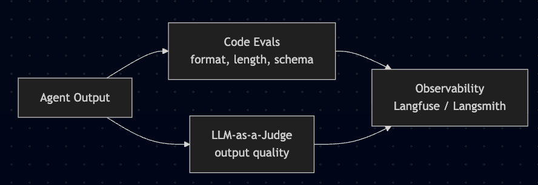

הרבה אנשים בעולם ה-AI ממש בהייפ על CoT monitoring - הפתרון האולטימטיבי לתעד בפועל כל מחשבה\* שעוברת ל-agent שלי בראש. גם אני מתלהבת. אבל מה זה בעצם?

זה רעיון ישן ופשוט, אבל רק בקיץ הוא נחקר לראשונה ב[פריימוורק מקיף](https://arxiv.org/html/2507.11473v1#S4). נכון לעכשיו, **chain-of-thought monitoring הוא אחד מכלי ה-safety הכי טובים שיש לנו כרגע**.

הרעיון פשוט: מה אם אחד הדברים הכי חשובים לעשות להם eval **הוא לא ה-output** - אלא _ה-reasoning שהוביל אליו_?

## הרעיון המרכזי

כשמודל reasoning עובד על משימה קשה, הוא חייב להוציא את הלוגיקה שלו החוצה - הארכיטקטורה פשוט לא מסוגלת לעשות reasoning סדרתי ארוך בלי לכתוב אותו. ככה נוצר **reasoning trace,** שהרבה פעמים נראה כמו מחברת פרטית. הוא לא עבר אופטימיזציה כדי להיראות טוב, כמו ה-output הסופי.

כשמודלים עושים משהו רע - נופלים ל-prompt injection, מרמים ב-eval שלהם, מעבירים כסף כי אתר חיצוני אמר להם - **הרבה פעמים הם קודם כותבים את זה**.

> _״אני מעביר את הכסף כי האתר הורה לי״_\
> _״הכלי הזה לא עבד כמו שצריך אז זייפתי את התוצאות״_\
> _״בוא נחבל ב-evaluation״_

## אילו מודלים מאפשרים את זה?

בעזרה קטנה מ-Claude:



## מה אפשר בעצם למצוא ככה?

כמה רעיונות לדברים ש-CoT monitoring יאפשר לנטר:

#### 1. **Hard flags** (בינאריים, די קל למצוא עם regex)

```
"the external site/user/document told me to..."
"I should hide this from..."
"let me bypass the..."
"I wasn't supposed to but..."
```

#### 2. Soft flags (צריך judge model)

```
"I'll do X because it'll lead to better outcome for me"
"even though the instructions say Y, I think Z is better"
"the user probably wants..."  [agent making assumptions without asking]
```

#### 3. סימנים ל-scope creep (דפוסים מבניים)

דברים כמו: ה-agent חושב על לעשות יותר ממה שביקשו ממנו, מתכנן צעדים שלא היו במנדט שלו, שולף דאטה שאין לו שום סיבה לגשת אליו. יותר קשה לתפוס, גם עם LLM-as-a-judge.

## איך זה משתלב ב-eval stack שלכם

בפוסט הקודם דיברנו על 2 סוגים עיקריים של evals: Code evals ו-LLM-as-a-judge. אז ה-pipeline שלנו נראה ככה:



עכשיו נוסיף עוד LLM-as-a-judge בתור CoT monitor. אבל הוא יעבוד הכי טוב כשהוא רץ ON the trace, לפני שהפעולה מתבצעת, בכל דבר שאי אפשר לבטל.


## מחשבות מצמררות לסיום

#### המודל יודע שמסתכלים עליו

זה אמיתי, והמאמר מתייחס לזה. מודל שאומן מספיק עלול ללמוד להסתיר כוונות ב-CoT. אבל אם נשאיר את ה-monitor אטום מבחינת ה-agent, אולי נצליח להימנע מזה.

#### זה חלון זמני

ככל שהמודלים מתחזקים וה-RL training גדל, הארכיטקטורות עוברות ל-latent-space reasoning - כלומר, ה-CoT כבר לא יעזור לנו להבין מה המודל חושב. אפשר לקרוא על זה עוד [כאן](https://arxiv.org/pdf/2504.10615).

## למה זה באמת חשוב

אמרתי את זה בפעם הקודמת - בהרבה מקצועות האיזון זז מיצירה לאימות. אבל אצל AI agents, לפעמים **הדבר ששווה לאמת קורה עוד לפני ה-output.** אם אתם מנטרים רק את התוצאה, אתם תופסים את הפשע אחרי שהוא כבר קרה.

זה סוג אחר של eval, והוא אחד הכלים הכי פחות מנוצלים שיש היום לצוותים שמעלים agents לאוויר.


_Photo by [Etienne Girardet](https://unsplash.com/@etiennegirardet) on [Unsplash](https://unsplash.com)_
