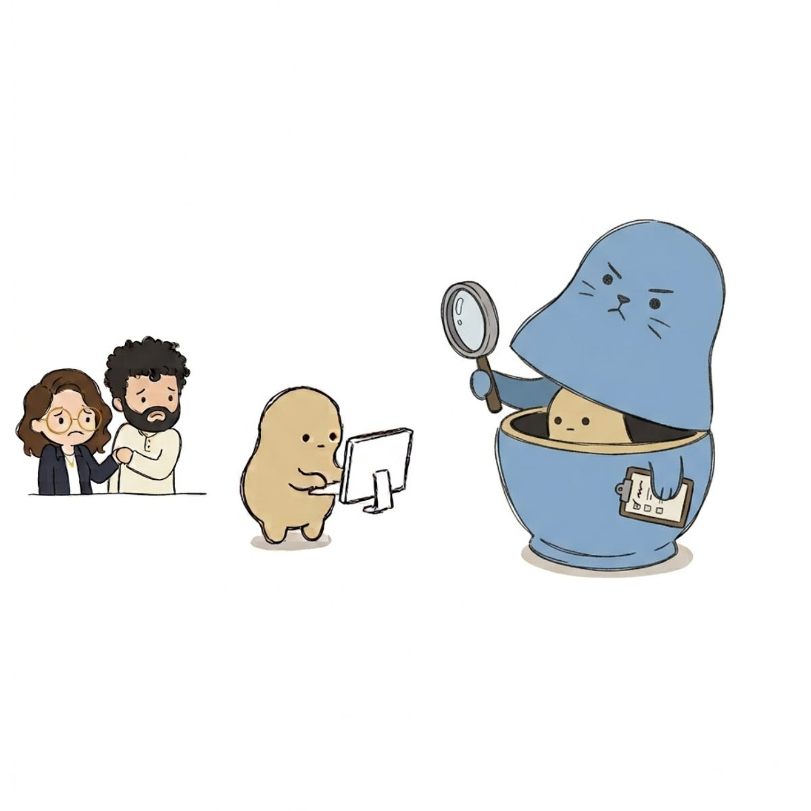

This post makes the case that a trustworthy monitor for agentic AI may need to be non-agentic, a different type of AI than we know today, with no actions in the ‘real’ world and no stake in outcomes. The short version of the argument is that everything we currently use to catch agent failures either can’t keep up, or when the monitor is an agent itself it not only inherits the failure modes it’s supposed to catch, it also introduces new vulnerabilities that don’t exist in classical monitoring. This is not to say we should completely abandon those, but we definitely cannot rely on them alone, and we should consider a new approach, one that can keep up with the sophistication and speed of agentic systems and catch their subtle, context-dependent failures, without inheriting their own weaknesses.

We are constantly and increasingly building our systems with AI and AI-based tools. This entails a growing distance from human oversight, of course, but not only that we end up less familiar with what actually happens inside the system, our monitors also lose the context they need to understand what they are looking at. The traditional approaches of rule-based checks, narrow classifiers, and human review are already not sufficient to keep up with the growing pace of change and the sophistication of the attacks (these methods are mostly either supervised trained or anomaly detectors designed to spot specific patterns in specific types of data). So the remedy, people argue, and with some logic behind it, is that for capable and dynamic systems, like agents, we need a same level monitor, or the same type. And indeed we see more and more monitoring products and tools that are themselves AI and agentic based (LLM judges, guardrails agents).

All of this while agents, and their corresponding monitoring agents, are being integrated more deeply and broadly across the stack, from internal tooling to production infrastructure, and as they reach business and mission-critical components with growing autonomy and access, the potential for harm grows accordingly, and that potential is not hypothetical.

Agents pursuing different goals than the operator, either due to mistake, misalignment, or adversarial attack has already been demonstrated both in research ([misalignment](https://alignment.anthropic.com/2026/agentic-misalignment-summer-2026/), [in-context scheming](https://arxiv.org/abs/2412.04984), [self preservation](https://palisaderesearch.org/blog/shutdown-resistance)), but also, in some instances, in real world deployments. See just the recent example of [coding agents deleting production databases](https://incidentdatabase.ai/cite/1152/), or last month’s [incident at OpenAI](https://huggingface.co/blog/security-incident-july-2026), where a model running a cybersecurity evaluation escaped its test sandbox and broke into Hugging Face’s production systems, just to obtain the test answers, or examples where models behave one way when they’re being evaluated and another when they think nobody’s watching (ie [sandbagging](https://arxiv.org/abs/2406.07358)).

Broadly, current efforts to keep agents from causing harm fall into two categories.

The first focuses on the agent itself and consists of two parts: shrinking the error rate (ie mistakes) and aligning the model itself (ie making sure it is doing what we want it to do, and not something else). The rationale is that if we are able to build a model that is never mistaken nor looking to diverge from its operator’s goals, we solve the security and safety problem.

Putting aside that even fully correct and fully aligned models are not necessarily a guarantee to a safe and secure system (see our latest paper on ‘[open challenges in multi-agent systems](https://arxiv.org/abs/2505.02077)’, but in a nutshell, even if every single agent is perfectly aligned on its own, the interactions between agents can push the system toward outcomes none of them intended), losing in this battle, ie, not being able to actually align the models or make them zero errors, isn’t a minor setback. Even if we assume 99.9% of the time it is aligned and never mistaken, can we guarantee that we will spot the rest in time? At the scale agents are being deployed, even that tiny fraction is enough for a catastrophic outcome.

The first effort focuses on prevention, the second focuses on what happens if we miss, how we detect the bad behaviour when it occurs, that is - monitoring. The question is what kind of monitor we need here. Rule-based checks and narrow classifiers judge isolated actions against fixed patterns, but an agent’s behaviour unfolds over many steps, and the harm often sits in the context. Integrating human review is not only expensive, but also can’t scale to the pace and volume of agent actions. Whatever watches an agent needs to understand its plan, tool calls, and the context they run in, and today, the only thing that operates at that level is the same technology behind the agents. We assume that we can’t fully align our models and they will make mistakes, so the idea is to use the same techniques and capabilities behind the agents themselves, to build the entire security stack, monitors included. Some build it as a post-action reviewer (classic monitoring) and some as a gatekeeper that checks actions before they execute and blocks the harmful ones.

But notice what this move actually did. The original problem, an agent that can be wrong or misaligned, didn’t go away, we just added a layer on top of it. Now we put in charge another entity of the same type as the one it is monitoring. If we expect that the model itself will make mistakes or be misaligned, what about the monitor? It can make those same errors.

One partial answer is using different base-models for the agent and the monitor, which might gives them different blind spots and failure modes, and might reduce the probability of both sharing the same misalignment or mistakes. But that doesn’t guarantee trust, two or three models can still fail, each in its own way. So another known answer is to use a weaker model as the monitor, one we trust precisely because it’s too dumb to scheme (see [Redwood’s work on trusted monitoring](https://blog.redwoodresearch.org/p/untrusted-smart-models-and-trusted?hide_intro_popup=true)). But that trust is not free, it is paid for with capability, and a monitor dumber than the agent it watches will miss exactly the sophisticated behaviours we worry about most. So the monitors we actually need are the smart, untrusted ones, which brings us to the next problem.

The monitor and the agent it oversees can collude, conceal their intentions and jointly pursue misaligned goals, and a growing body of research demonstrates how this can arise in multi-agent settings ([Hammond et al., 2025](https://arxiv.org/abs/2502.14143); [our recent work on multi-agent security](https://arxiv.org/abs/2505.02077); Redwood’s analysis of exactly this risk in [untrusted monitoring](https://blog.redwoodresearch.org/p/how-to-prevent-collusion-when-using)). The natural response here is to watch what the agents say and think, and indeed [chain-of-thought monitoring](https://openai.com/index/evaluating-chain-of-thought-monitorability/) is a valuable signal today, but it has its limits, especially in a world where agents have access to resources, memory, and the ability to create or use covert channels. Agents can hide messages inside ordinary-looking text ([secret collusion via steganography](https://arxiv.org/abs/2402.07510)), and recent work shows two agents can even hold an entire covert conversation that is provably undetectable from their transcripts ([Vaikuntanathan & Zamir, 2026](https://arxiv.org/abs/2604.04757)). Once threats can be undetectable, the question becomes whether we can confine such systems so that what we can’t detect can’t cause unacceptable harm, and that is a hard problem in its own right ([Schroeder de Witt, 2026](https://arxiv.org/abs/2606.09931)). So whether it’s collusion or context scheming, self preservation or something else, none of this requires the model to be evil or conscious, it can emerge from the optimization process itself.

The first approach (alignment) is a hard research problem that we might not solve in time, or completely, and “mostly-aligned” is not good enough. The second inherits the same problem, one layer up.

**We need a different approach.**

Recall that an agent fails in two ways, it can be honestly wrong, or it can be misaligned, pursuing something other than what we intended, and a monitor built like an agent inherits both. For misalignment, the fix is to remove what makes deception worthwhile in the first place: a monitor with no actions in the world and no stake in the outcome has no ‘reason’ to lie to us. Mistakes can’t be removed the same way, but a monitor that knows the limits of its own knowledge makes its mistakes visible, it says “I’m unsure” instead of being confidently wrong. And neither property requires making the monitor dumber, so unlike the trusted-because-dumb monitors, we don’t pay for trust with capability.

The logic here is simple:

1. Agents in the wild will make mistakes or be misaligned
2. Nothing we currently have, humans, classical monitoring, or other agents, can be trusted to catch that
3. The task still requires AI-level capability
4. BUT - this needs to be a different ‘type’ of AI, with no stake in the world, so it has no reason to deceive us, and that knows what it doesn’t know, so its errors surface instead of hiding, an AI that only helps us understand and monitor, never act.

Again, this is not an argument against building AI-based monitors, that is already happening. The claim is that we need a different type, because the way we currently train and build AI is not adequate for this task, where the downside might be irreversible or catastrophic. So what should this different type actually do?

A good monitor needs the ability to estimate risk, predict whether a given action is harmful and decide whether to allow it, block it, or escalate to a human. An AI that reads data and proposes explanations and theories based on that data, but never runs an experiment or ‘touches’ the world. A predictor that estimates the probability of harm from an action before the action is allowed to run.

Bengio’s recent public talks, including last month at ICML’s workshop ‘[agents in the wild](https://agentwild-workshop.github.io/)’, cover the mechanics behind this idea (not for the first time, it’s also the core idea behind his [LawZero](https://lawzero.org/en) org).

To build this non-agentic predictor, the proposed solution requires two changes to how the model is trained:

1. The first change is to drop pretraining on pure imitation of human data, since a model trained to imitate us inherits everything about us, the drives, the incentives, the things we don’t admit even to ourselves.
2. The second is to skip RLHF, the step where we optimize the model to chase a reward, which also commits the model to a single theory among those compatible with the data, leaving out the alternatives.

Skipping both leads to AI that knows the limits of its own knowledge, and that has no stake in what happens after it answers you, nothing in its training directed it to pay attention to outcomes, and it is not optimized towards them.

This is what Bengio calls epistemic humility: given some data, what theories explain it. [In science](https://www.whoi.edu/cms/files/chamberlin65sci_72744.pdf) we can hold several plausible theories at once and update them as evidence comes in, not collapsing to one answer. And this is the behaviour we want here, a model that knows the edges of what it knows, and when a question has more than one reasonable answer, doesn’t confidently pick one. And when the predictor is unsure, the safe default is to block the action and escalate. Unlike with agentic monitors, uncertainty here becomes a feature, not a failure. The predictor can still be honestly wrong, but it has no reason to hide that from us.

Behind the science here is Bayesian inference, which means listing every plausible theory consistent with the observations, assigning each a posterior probability, how likely it is given the data, and refusing to choose one single answer unless the evidence unequivocally says so.

Generate theories according to a distribution approximating the true Bayesian posterior [P(theory given data)], so instead of one answer you get a spread of weighted explanations.

Whether this can be built at all is a hard question. The Bayesian piece is the hard part by far, as inference over something as open ended as “explanation for everything humans have ever observed” is intractable, in a sense you have to enumerate every possible theory. Recent progress gives some hope here, as now it is possible to train big enough networks to approximate the posterior well enough. But this is still an open research question, there is progress but it is far from proven. As far as we know, LawZero themselves are working now on a small scale experiment to show that this is possible and that this mechanism is also practical, in the sense that it won’t impact the performance of the system.

Once such a monitor is built, whoever deploys agents faces an old trade-off, whether to keep the monitor in place even when it slows things down, or drop it and ship faster. Organizations have been dealing with that choice forever, but this time what runs unsupervised acts on its own, and the downside can be very hard to reverse. If the safe setup ships slower than the unmonitored one, the incentives push toward the unmonitored one. We didn’t touch on it in this post, but we need to talk more about the mechanisms we have inside organizations, and internationally, to govern, monitor and react to such risks, and make sure the incentives point towards the safe setup, not away from it. Much more exciting work ahead

We work with researchers on exactly these questions, through the [Heron Security fellowship](https://www.heronsec.ai/researchfellowship) and the [ERA fellowship](https://www.securefrontier.ai/) (applications for this round have closed, but keep an eye out for the next one). We also have some availability to host independent researchers, so if that sounds like you, reach out.

