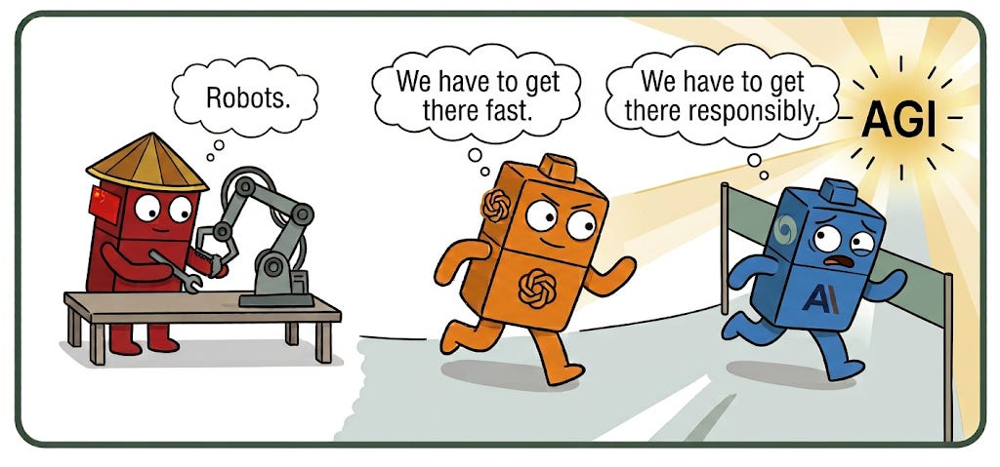
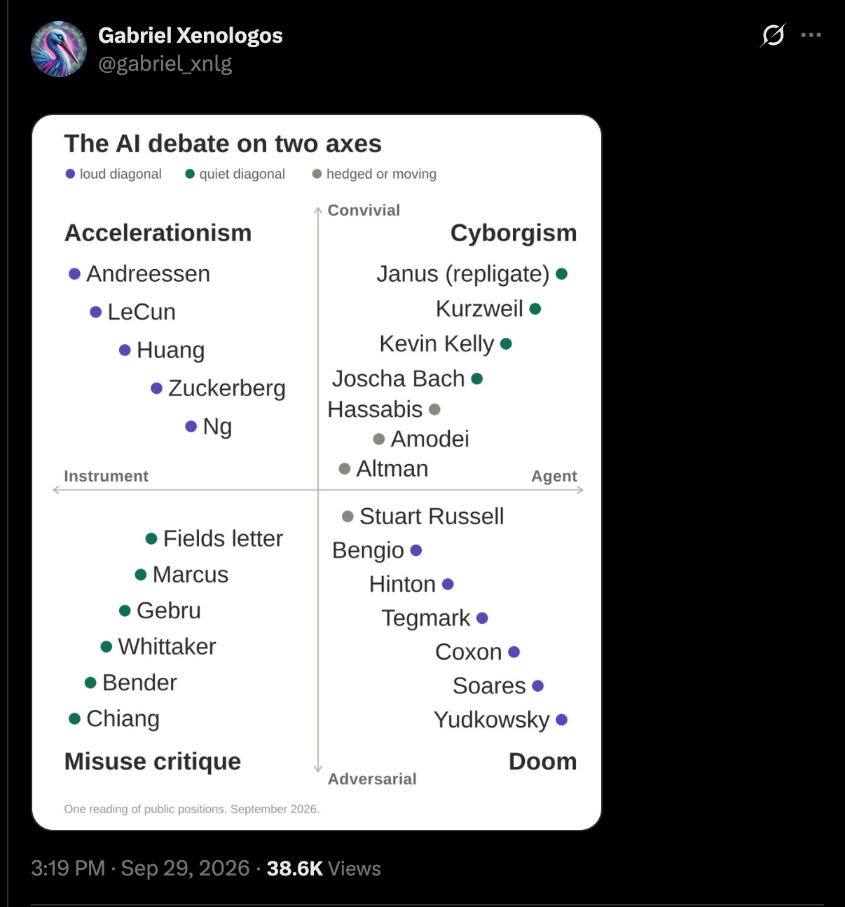

בשבועות האחרונים, AI safety בכל מקום. בכירי המעבדות באו לבית הלבן לחתום על הסכם פיקוח על המודלים; הוכרז מינוי של [צאר AI](https://www.theguardian.com/us-news/2026/oct/04/trump-jay-clayton-white-house-ai-czar); אנחנו ממשיכים לראות עוד ועוד [תקריות misalignment](https://alignment.openai.com/misalignment-reports/); דריו מוציא בלוג בשם [Pace the frontier](https://darioamodei.com/post/we-must-pace-the-frontier) שגם סם אלטמן ואילון מאסק, באופן מאוד חריג, הסכימו עליו.

ועדיין, בשבועיים האחרונים כל המעבדות הגדולות שחררו מודלים חדשים וחזקים יותר.

#### **וואט דה פאק.** למה הם לא עוצרים?

כדי להבין את זה, חשוב להכיר קצת את ההיסטוריה ואת הכוחות הפוליטיים בעולם הזה. המטרה של הבלוג היא לחלוק את התובנות, התפישות והמחשבות שלי על יחסי הכוחות - כמו בכל שוק, ברגע שמבינים אותם הרבה דברים מתבהרים.

##### קצת היסטוריה

החברה OpenAI קמה ב-2015 בתור ארגון ללא מטרות רווח, כדי לבנות גביע קדוש: AGI to benefit humanity. כמעט כל החוקרים הגיעו מגוגל, והרעיון של להקים ארגון שרק יחקור ויפתח טכנולוגיה פורצת דרך קסם מאוד להרבה מהם.

אבל, גן העדן לא החזיק תקופה ארוכה. בשנת 2020[^1] עוזבים דריו אמודיי (שהיה VP research), אחותו דניאלה ועוד 5 חוקרים בכירים את הארגון, בטענות קשות של אובדן אמון בסם אלטמן, שלדבריהם שיקר והסתיר מהם מידע קריטי.

בנוסף, היו ביניהם חילוקי דעות עמוקים מאוד על קצב הפיתוח המהיר מול השאיפה ל-safety - שבתחילה הייתה חלק חשוב מהאתוס בארגון, ולאט לאט נשחקה. הם טענו ש-OpenAI מקריבים את הדאגה מהסכנות הקיומיות שהטכנולוגיה עלולה לגרום - כדי למקסם על רווחים ופיתוח מהיר.

לכן החליטו לבנות חברה מתחרה, שתגיע מהר יותר ל-AGI - אבל שיהיה AGI בטוח ואחראי, וככה הוא ינצח את ה-AGI הכאוטי שבונים ב-OpenAI.

#### מלחמה קרה

שורש הויכוח הוא קצב הפיתוח, כשאמריקאים מצדיקים את ה-scale at all costs בטיעון של איום קיומי מצד סין, על מי ינצח במירוץ להשגת הנשק האולטימטיבי: AGI.

גם פה בעצם חוזר הטיעון של ״אנחנו המעצמה הטובה, שמביאה את הקדמה בצורה הנכונה בניגוד לסין שתעשה את זה בחוסר אחריות״. כלומר, אם רק נאט את הקצב בגלל רגולוציות או ויכוחים פוליטיים - סין תשעט קדימה ותנצח במירוץ. זו הסיבה שגם מקפידים על הגבלות מאוד מאוד מחמירות על מכירת compute.

אז יש לנו פה **מרוץ חימוש**:

1. אנטרופיק רוצים להספיק להגיע ל-AGI לפני OpenAI כי הם טוענים שהם היחידים שיעשו את זה באחריות
2. ב-OpenAI רוצים להספיק להגיע לשם לפני הסינים
3. הסינים… בעיקר מתמקדים ב-Applied AI (רובוטיקה), ושומרים באופן די יציב על הביצועים של המודלים הפתוחים שלהם בערך 6-9 חודשים אחרי המודלים המערביים.[^2]

*והנה בציור קצת פוגעני שכמובן לא מציג את כל המורכבות אבל נהנתי ליצור אותו*

כולם (כלומר כל האמריקאים) מניחים שהסינים לא יסכימו לעצור.

האמת היא שהסינים דווקא מאוד [פעילים](https://aisafetychina.com/) ב-safety ושרים בממשלה התבטאו בנושא הזה כבר לפני כמה שנים. יצא לי גם לדבר עם חבר׳ה במעבדות שם שמתעסקים בנושא. כזכור גם סין היא אימפריה שהחזיקה אלפי שנים - הם יודעים לחשוב הרבה קדימה.

אז היו די הרבה תקוות לקראת הפגישה בין טראמפ, הנשיא שי ומנכ״לי המעבדות - אבל נראה בינתיים שלא יצא ממנה הרבה.[^3]

#### על איזה הסכם בכלל מדברים?

הרעיון המרכזי הוא דרישה מהממשלות החזקות לעזור במאמץ דיפלומטי-בינלאומי לעכב את ההתקדמות הטכנולוגית, כדי שנוכל לפתור בעיות של AI safety כמו alignment או security, ולהכין את העולם כולו למודלים חזקים - למשל, לחזק את האבטחה של תשתיות קריטיות או של ממשלות לפני יציאה של מודלים עם יכולות מאוד מפחידות.

הפתרון המקובל על הקהילה למירוץ החימוש נקרא Plan A - הסכם פיקוח הדדי בין המעצמות, דומה להסכם הבינלאומי שיש לנו עם גרעין. הסבר על הרעיון מופיע [כאן](http://AI-2040.com) [^4].

#### כש-AI safety נכנס למיינסטרים

שאלות מדעיות שהיו בעבר נחלתם של חוקרים נישתיים בברקלי ובאוקספורד הופכות לשאלות **פוליטיות וכלכליות**. זה לא תהליך חדש, אבל הוא רועש יותר מאי פעם ופוגש דמויות שמעולם לא התייחסו אליו [^5]. לי הטבלה הזו מאוד עזרה למפות בצורה נוחה את הפוליטיקה של ה-AI - בואו נסתכל עליה ביחד.

ציר ה-x מייצג את איך תופסים מה זה בעצם AI: האם **כלי** אינסטרומנטלי שאנחנו מפעילים (״[טכנולוגיה נורמלית](https://www.nytimes.com/2026/10/09/opinion/ezra-klein-podcast-arvind-narayanan.html)״) או שהוא **אייג׳נט/ישות**, שיכולה לפעול בעולם עם כוונה ומודעות, שיכולה לתכנן ולקבל החלטות (או יש עם פוטנציאל להיות כזו).

ציר ה-y מייצג את מה חושבים על היחסים בין AI לבין האנושות: **חברותיים** או **עוינים**. או גם, האם אופטימיים או פסימיים.

#### (כלי // חברותי) Accelerationism

מאמינים שמדובר על התקדמות טכנולוגית מרגשת, כלי שיביא לצמיחה ושגשוג, ומתנגדים מאוד לרגולציה (בעגה: e/acc).

- יאן לקון, מדען AI מפורסם שבעיקר חושב ש[כולם מגזימים](https://fortune.com/2026/10/01/ai-godfather-yann-lecun-has-zero-concerns-about-human-extinction-says-anthropic-ceo-dario-amodei-is-deuded/) ו-LLMים [לא יכולים](https://x.com/rohanpaul_ai/status/2106337846198214728) להיות AGI

- [ג׳נסן הואנג](https://www.bbc.com/news/articles/cr5ye7p13jg7o) מ-Nvidia (חברה, שכזכור, שגדלה מהדרישה לעוד AI)

- מארק אנדריסן, [במניפסט](https://a16z.com/the-techno-optimist-manifesto/) המפורסם שלו בעד התקדמות טכנולוגית. וגם היום, a16z הם קול מאוד בולט נגד האטה.

#### (ישות // חברותית) Cyborgism

שואפים להתמזג עם AI, תופסים את זה בתור השלב הבא של התודעה והחברה האנושית.

- ריי קורצווייל, בספר המפורסם [The Singularity Is Near](https://www.singularity.com/), שמתאר ממשקים ביולוגיים-טכנולוגיים. האמת שהוא היה עתידן די מוצלח

- זה היה בשנות ה-80 אבל נזכרתי [במניפסט](https://www.cambridge.org/core/books/abs/postmodern-turn/manifesto-for-cyborgs-science-technology-and-socialist-feminism-in-the-1980s/F3C18816B1030A3AE5ECCFE1F5404A1C) המכונן (והלא מספיק מוכר [^6]) של דונה הארווי על איך הטכנולוגיה מטשטשת את הגבולות המגדריים המסורתיים, ואיך בסימביוזה כזו יש פוטנציאל לשחרור קוגנטיבי ותרבותי - כשמשתחררים מהגוף.

#### (ישות // עוינת ) Doomers

מתמקדים בסיכונים הקיומיים של AGI - שה-AI יהפוך לישות על-אנושית, שתגרום להשמדה שלנו. התקווה (חוץ מלעצור) היא לפתור את בעיית ה-alignment - איך נדאג לזה שה-AI לא ירצה לפגוע בנו ולא יפגע בנו גם בטעות כשהוא ממקסם על מטרות.

זה הבסיס העקרוני להקמה של אנטרופיק, הרבה מאוד מהעובדים המקוריים של OpenAI שמאמינים בזה עזבו לשם.

- ההוגה המפורסם ביותר הוא אליעזר יודקובסקי [^7], חוקר AI מפורסם שמדבר המון על הסכנות מפיתוח AGI. הספר האחרון שלו נקרא [If Anyone Builds It, Everyone Dies](https://ifanyonebuildsit.com/).

- ספר מפורסם נוסף ומכונן הוא Superintelligence של ניק בוסטרום

- גם ג׳פרי הינטון ויהושע בנג׳יו, שני חוקרים חשובים שתרמו רבות ל-deep learning המודרני, עכשיו מזהירים איך היא יוצאת משליטה.

#### (כלי // עוין) Misuse critique

הם לא חושבים שמדובר על ישות אינטליגנטית אלא על כלי חזק, וטוענים שהדיון על האם AI ישמיד את האנושות בעוד 20 שנה מסיט את תשומת הלב מהנזקים שהוא גורם כבר היום - ריכוז כוח והון, מחיר סביבתי, פגיעה בפרטיות, אפילו סכנות טכנולוגיות שיגיעו יותר ויותר.

זוכים לדעתי בפרס ה-copy עם שמות באנגרים כמו:

- המאמר [On the Dangers of Stochastic Parrots](https://dl.acm.org/doi/10.1145/3442188.3445922) - שהיה מאמר כזה שערורייתי שגרם לפיטורים של אחד הכותבות מגוגל [^8]

- סופר המד״ב טד צ׳יאנג במאמר [No, Artificial Intelligence Is Not Conscious](https://www.theatlantic.com/philosophy/2026/06/no-artificial-intelligence-is-not-conscious/687378/)

#### למה כל זה מעניין?

המון פעמים הדיון מרודד לבעד או נגד (בעיקר עם אמריקאים). הסיבה שאני מחבבת את הגרף הזה היא כי הוא מאפשר לנו להבין את מארג הכוחות, וגם מאפשר לכל אחת ואחד מאיתנו לשים את עצמם על הצירים האלה. תוכנה סטטיסטית או ישות עצמאית? מה הקשר שנרצה אליה? איפה הסכנות, איפה ההזדמנויות?

האלכסון הסגול, שמראה את הויכוח בין האקלסרציונסטים והדומרים, הוא זה שעושה הכי הרבה רעש. שניהם חולקים הנחת מוצא - מדובר בטכנולוגיה כמעט אלוהית. זה הדיון הכי אמוציונלי - גן עדן טכנולוגי מול סוף העולם.

האינטרסים הכלכליים חשובים תמיד - קשה לומר שמנכ״לי החברות הגדולות לא נהנים מהויכוח. כשאנשים מפחדים מאיזה כוח עליון המניות עולות, ורגולציה כמו שהם מבקשים עלולה לייצר חסם כניסה עצום למתחרים קטנים או לקוד פתוח. **זה יכול להסביר את הדיסוננס בין ההפחדה להמשיך פיתוח**.

חסרה כאן סין, כי כרגיל אנחנו מתמקדים רק במערב. הייתי קוראת לתפיסה היום בסין ״אינסטרומנליזם מדינתי״ - שאומר לעבוד קשה כדי לפתח AI בתור כלי גיאופוליטי וכלכלי, תוך פיקוח הדוק של המדינה.

> אם רוצים למצוא מי אתם על הצירים האלה - הנה [שאלון](https://tribes.thefai.org/) מצחיק שממפה את השבטים של ה-silicone valley. יש שם אפילו עמוד Vocabulary

### מה הלאה?

שאלה טובה. יוצא לי להתווכח עם לא מעט חוקרים על שאלה של timelines (הם אומרים שנמות בעוד שנתיים, אני אומרת שאני אמות זקנה). אבל הקצב באמת מאוד, מאוד מפחיד. ההתקדמויות ביכולות מסוימות (כמו מתמטיקה או קוד) עקפו בהרבה גם את התחזיות השמרניות.

האם בכלל אפשר, בכלכלה והפוליטיקה והחברה של היום, לעצור או להאט? אני חושבת שזה יהיה קשה מאוד. ההבטחה ברעיון של AGI, החל מהחזון הכלכלי של החלפת העובדים האנושיים ועד החזון הכמעט-דתי של לייצר אינטליגנציה - כל כך מפתה שקשה לעולם להתנגד.

הכוחות הכלכליים-חברתיים-פוליטיים, מתודלקים ברעש ובתיאבון בלתי נשלט לטוקנים, דוחפים כל כך חזק קדימה. הקולות לעצור או להאט נעמדים מולם, ולכן הדיון הופך לפוליטי ורדוד. מי שדוחפים קדימה לא מוכנים לשמוע על רגולציה, למרות שבעצם רגולציות ונהלים עזרו לנו מאז ומעולם למסד התקדמויות טכנולוגיות גלובליות ולוודא שהן נגישות ובטוחות (תעופה, גרעין, ..)

#### אבל, לא הכל אבוד!

אני עושה קראטה הרבה שנים. רובכם לא מכירים אותי אבל אני די קטנה, ולכן הייתי חייבת ללמוד טכניקות. אחת מהן היא שכשאגרוף של יריב מתקרב, הרבה יותר יעיל **להשתמש** בכוח והתנופה שלו מאשר להתנגד להם. במקום להיעמד מול המכה ולחסום אותה ישירות- להסיט אותה לכיוון שאני רוצה.

> אני מאמינה בלב שלם שאפשר **להסיט את ה-trajectory של ההתקדמות לכיוונים חיוביים** - תוך שימוש בתנופה והכוח הענקיים שמופעלים.

זה **P(bloom) -** במקום P(doom), שהוא ההסתברות ש-AI ישמיד את האנושות, אני רוצה לדבר על ההסתברות שדווקא נשגשג. זו לא נאיביות, אלא אופטימיות רדיקלית - נעבוד קשה, וביחד, כדי לוודא שהעולם יצליח. זו הכותרת של הבלוג הזה של עוד דברים שתפגשו בעתיד :)

יש מה לעשות. אני עובדת על זה בכל הכוח, ואני לא היחידה. אם מעניין אתכם לקחת חלק- אשמח לעזור.

---

שוב תודה לחברים רבים שעזרו לי לחשוב על הדברים כאן.

---

**לסיום, קצת המלצות תוכן:**

פרק מרתק ומפחיד על מאחורי הקלעים של המעבדות

[AI Expert: We Have 2 Years Before Everything Changes! We Need To Start Protesting! - Tristan Harris (FlightStory)](https://open.spotify.com/episode/1S8FEbhkaQQ8Yrx4e3f5Vh)

הספר [Empire of AI](https://karendhao.com/) של Karen Hao ולמי שאין זמן אז רק הפרק הזה

[We All Suffer from OpenAI’s Pursuit of Scale w/ Karen Hao [Replay] (Paris Marx)](https://open.spotify.com/episode/6fvizxWSZEIPO9sASl80vb)

[^1]: [https://www.theatlantic.com/technology/2026/09/openai-v-anthropic-inside-biggest-rivalry-tech/688819/](https://www.theatlantic.com/technology/2026/09/openai-v-anthropic-inside-biggest-rivalry-tech/688819/)

[^2]: הם עושים את זה באמצעות טכניקה שנקראת distillation, שהיא בעצם סוג של reverse engineering למודלים האמריקאים הסגורים. הם עושים מאות אלפי קריאות כדי ללמוד איך הם עובדים ואיזה תשובות הם נותנים לאיזה שאלות. דווקא יש יופי של טאלנט סיני במחקר AI - אבל המערב מגביל בצורה אקוטית מכירה של compute לסין ולכן יש מחסור בחומרה, שקריטית לתהליך האימון. הם מצליחים להשיג חומרה (בעיקר דרך סינגפור, לפי מקורות זרים) אבל נדרשים ליצירתיות.

[^3]: כמובן, לא מאוד עוזר [שטראמפ פוסל](https://www.bbc.com/news/articles/cwly5lmvy38qo) כל שיתוף פעולה מראש.

[^4]: גילוי נאות: תרמתי שם קצת, ממש קצת. מצד שני יש לי לא מעט השגות על העבודה לקראת הסכם, בעיקר איך רוב החוקרים בנושא נוטים להתייחס לזה בתור בעיה טכנולוגית (״איך נעשה verification כדי לוודא שה-GPU במצב inference ולא במוד training״) ולא בתור הבעיה שהיא בעצם - דיפלומטית/פוליטית /כלכלית. אבל מתחילים לקום גם ארגונים נהדרים שעובדים קשה מאוד על שאר האספקטים של הבעיה, ומחברים בין ברקלי לוושינגטון.

[^5]: מביך לומר שאחד האנשים שהכי הסכמתי איתם בחודש האחרון היה מארק צוקרברג, שעקץ את דריו וסם עם האמירה ״אנחנו בילינו את החודשים האחרונים בלדאוג ל-safety ו-security של muse (האייג׳נט החדש שלהם) כי זו האחריות שלנו כשאנחנו מוציאים מוצר״.

    אולי האמירה הזה מכילה בתוכה את ההבדל בין אנשי מוצר שמחויבים ללקוחות ומבינים את האחריות העסקית שלהם (לפחות בתיאוריה), ובין חוקרים שרודפים אחרי ההישג המדעי הכי גדול שהם רק יכולים.

    אה, וכמובן אינטרסים כלכליים - שאף אחד לא יעז to pace the frontier. אבל גם הקודם.

[^6]: לפחות למי שלא לקחו את הקורס אפיסטמולוגיה פמיניסטית במחלקה לפילוסופיה של המדע, ניחוש פרוע שמדובר על רובכם!

[^7]: למי שמתעניינים, קריאה מומלצת שמעבירה בצורה ברורה את הפחדים והסכנות והתפישות של מי שמודאגים מ-AGI. חוץ מזה, יודקובסקי גם כתב את הספר ״[הארי פוטר והשיטה הרציונלית](https://www.fanfiction.net/s/5782108/1/Harry_Potter_and_the_Methods_of_Rationality)״, פאנפיק מפורסם שמסביר את הקסמים בעולם של ג׳יי קיי רולינג באמצעות חשיבה מדעית ורציונלית. יציאה מהארון שמתחת למדרגות: לא אהבתי

[^8]: הטענה במאמר (לא מפתיע) היא ש-LLMים הם טכנולוגיה שמחברת ביחד משפטים לפי training data, שנשמעים קוהרנטיים וברורים אבל זה לא אומר שהם חושבים או שהם ״מבינים״ את מה שהם אומרים. Gebru, אחת הכותבות, טענה שהיא פוטרה מצוות ה-Ethical AI של גוגל אחרי שהמחלקה המשפטית לא הסכימה שהיא תפרסם את המאמר (או שהיא תוריד את השם שלה). גוגל הכחישו.
